# Unofficial null²-inspired sketches for M5Stack

> **お断り(非公式)**
> これは **ファンによる非公式の個人作品** です。
> パビリオン「null²」とその制作者、および万博の関係者・権利者とは一切関係がなく、
> 許諾も受けていません。公式の配布物でも、公式の移植版でもありません。
> 実物の映像・音声・設計データ・プログラムは一切使っておらず、
> 画面に出るものはすべて、その場で計算して描いています。
> リポジトリ名の "null2" は、着想元を示すためだけの表記です。

大阪・関西万博 2025 のパビリオン **null²** を見て、
あの「生きている鏡」を手のひらの上で動かしたくて書いた Arduino スケッチ集です。

丸い 466×466 の AMOLED を持つ **M5Stack StopWatch** が主なターゲットですが、
どのスケッチも **CoreS3 / CoreS3 Lite / CoreS3 SE**(320×240)でも動きます。
画面の形を見て、自動で切り替わります。

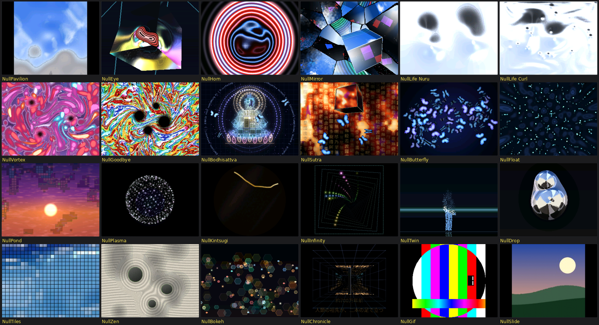

### ▶ ブラウザで試す

**https://laughingmanjp.github.io/nullnull-Imitation-tool/**

本体がなくても、29作品ぜんぶをメニューから選んで動かせます(NullGif の GIF や NullSlide の写真も、エミュレータの中へ入れて試せます)。
本体に書き込むのと同じ C++ を WebAssembly にしたもので、画面・ボタンA/B・タッチ・傾き(パッド、またはスマホの傾きセンサー)・マイク(NullGoodbye)が使えます。
StopWatch(丸い画面)と CoreS3(四角い画面)を切り替えられます。速さは本体とは違います。

GIF や写真は、PC からは本体を **USB メモリ** にして入れます(NullGif / NullSlide の設定の「USB メモリになる」)。スマホからは本体の Wi-Fi で送れます。

---

> 📘 **パソコンから StopWatch に書き込む方法は [HOW_TO_WRITE.md(書き込み方)](HOW_TO_WRITE.md)** にくわしく書いてあります。

## 入っているもの

フォルダ名の `_v1` `_v2` … は版の番号です(数字が大きいほど新しい)。
このリポジトリには、それぞれの最新版だけを置いています。

| スケッチ | 何が映るか | CoreS3 |
|---|---|---|
| [**NullMenu_v97**](NullMenu_v97/) | **29本ぜんぶ入り**。1回書き込むだけで、本体のメニューから好きな作品を選んで動かせる | ○ |
| [**NullEye_v4**](NullEye_v4/) | 宙に浮かぶ鏡の立方体と、その中央でうねる眼 | ○ 全画面 |
| [**NullHorn_v4**](NullHorn_v4/) | ラッパ形のくぼみの奥で光る、赤と青のリング | ○ 全画面 |
| [**NullMirror_v5**](NullMirror_v5/) | 割れた鏡の部屋と、浮かぶ立方体 | ○ 全画面 |
| [**NullPavilion_v6**](NullPavilion_v6/) | 空と広場を映す鏡が波打つ。見え方は「鏡の膜」「鏡の建物」「鏡の水面」の3つ | ○ 真ん中に正方形 |
| [**NullLife_Nuru_v6**](NullLife_Nuru_v6/) | ぬるっと動く鏡の膜 | ○ 全画面 |
| [**NullLife_CoreS3_Nuru_v1**](NullLife_CoreS3_Nuru_v1/) | 上の CoreS3 専用版 | CoreS3 専用 |
| [**NullLife_Curl_v7**](NullLife_Curl_v7/) | 鏡の膜 + 見えない渦の流れ(カールノイズ)。膜の模様が大理石のように流れる | ○ 全画面 |
| [**NullVortex_v5**](NullVortex_v5/) | うねる光の膜に渦が空いて、まわりの塊を吸い込んでいく | ○ 全画面 |
| [**NullSutra_v8**](NullSutra_v8/) | 炎の雲に照らされて、般若心経の文字の柱が流れる暗い鏡の部屋 | ○ 全画面 |
| [**NullButterfly_v6**](NullButterfly_v6/) | 暗い空に、たくさんの蝶がゆらゆら舞う(5〜100匹) | ○ 全画面 |
| [**NullBodhisattva_v22**](NullBodhisattva_v22/) | null菩薩。クラスの箱・降る般若心経・null になる分身・傾けて動く合わせ鏡の4つの場面で見せる菩薩 | ○ 全画面 |
| [**NullGoodbye_v13**](NullGoodbye_v13/) | サイケデリックな液体の模様が、黒いブラックホールへ渦を巻いて吸い込まれる。音に反応し、穴は触って育てたり結合したりできる | ○ 全画面 |
| [**NullFloat_v6**](NullFloat_v6/) | 見えない音の波の「節」に、光の粒が集まって浮かぶ | ○ 全画面 |
| [**NullPond_v6**](NullPond_v6/) | 空を映す水面が、ところどころピクセルに「デジタル化」して、また自然へ溶けて戻る | ○ 全画面 |
| [**NullPlasma_v6**](NullPlasma_v6/) | 空中の光の点描。光の点が、回りながら球・トーラス・蝶・二重らせんに組み変わる | ○ |
| [**NullKintsugi_v6**](NullKintsugi_v6/) | 黒い漆の器を叩くとヒビが走り、そこに金が流れこんで継がれていく | ○ |
| [**NullInfinity_v6**](NullInfinity_v6/) | 合わせ鏡の部屋。鏡のふちと光の点が、奥へ奥へと回りながら無限に続く | ○ |
| [**NullTwin_v6**](NullTwin_v6/) | 光の立方体でできた人の姿が、走査線で組み上がっては崩れていく | ○ |
| [**NullDrop_v6**](NullDrop_v6/) | 液体金属のような鏡の雫が、景色を映しながらくっついたり離れたりする | ○ |
| [**NullTiles_v6**](NullTiles_v6/) | 外壁のような鏡のタイルが風でうねり、空を映してきらめく | ○ 全画面 |
| [**NullZen_v9**](NullZen_v9/) | 計算機の枯山水。月夜の砂 / 墨の庭 / 光る砂 の3つの見え方。なぞると熊手の溝 | ○ 全画面 |
| [**NullBokeh_v6**](NullBokeh_v6/) | 夜の光が六角形の玉ボケになって浮かび、ピントがゆっくり呼吸する | ○ 全画面 |
| [**NullChronicle_v7**](NullChronicle_v7/) | 人類の歴史とこれからの AI の年表が流れる鏡の部屋。見え方は「鏡の回廊」と「文字の塔」の2つ。触ると文字が散り、傾けると角度が変わる | ○ |
| [**NullKaleido_v12**](NullKaleido_v12/) | うずを巻いて流れる、ぬるぬるの光のマーブル模様。うずの中心に黒いつやつやの玉からうねりが広がり、光の粒がピカピカまたたく。触った所に新しいうずが生まれる | ○ 真ん中に正方形 |
| [**NullGalaxy_v20**](NullGalaxy_v20/) | 立体の渦巻き銀河と、ジェットを噴くクエーサー、馬頭星雲。ボタンA で超新星爆発が起き、銀河が null(無)になって、また生まれ直す。なぞると回したり倒したりできて、はじくとずっと回る。タップで星が生まれる。傾けると見る角度が変わる。色のある「写真」と、銀と黒の「銀」の見た目を切りかえられる | ○ 真ん中に正方形 |
| [**NullCloud_v6**](NullCloud_v6/) | 高い空から見下ろす雲の海。雲がゆっくり流れ、雲の上に虹の輪(光輪)が浮かぶ。朝・昼・夕方・夜を切りかえられる。タップで光輪が生まれ、なぞると向きと見下ろす角度が変わる | ○ 真ん中に正方形 |
| [**NullSapiens_v3**](NullSapiens_v3/) | さようなら、ホモ・サピエンス。体を輪切りにした光の線でできた人が、頭の輪から1本ずつ糸になってほどけ、髪のように束になって光の方へ流れていく。しばらくすると巻き戻る。夜明け前・夜・夕暮れを切りかえられる。タップでほどける / 巻き戻る、振ると胸までほどける | ○ 真ん中に正方形 |
| [**NullSunset_v6**](NullSunset_v6/) | 夕凪の海。もこもこした雲の天井が日の色に光って流れ、日がゆっくり沈む。細かい波が重なった水面に、雲と夕焼けが砕けて映り、日の光はきらめく道になる。空は金色 → 夕焼け → 星空 → また朝へ。海をタップすると、しずくを落としたような波紋、なぞると指のあとに波紋が続く。空をタップすると鳥の群れ、空を左右になぞると時間が前後に動く。傾けると向きと水平線が動く | ○ 真ん中に正方形 |
| [**NullGif_v9**](NullGif_v9/) | スマホ(本体の Wi-Fi)から送ったり、PC から USB メモリとして入れたりした GIF を、丸い画面で流す。1回流し終わると次の GIF へ | ○ ※ |
| [**NullSlide_v10**](NullSlide_v10/) | スマホ(本体の Wi-Fi)から送ったり、PC から USB メモリとして入れたりした写真のスライドショー。切り替え方・時間・順番・形(そのまま / ハート)を選べる | ○ ※ |

NullPavilion は、空・建物・床が正方形にちょうど収まるように描いてあるので、
CoreS3 では左右に黒い帯が出ます(引き伸ばすと空か床が切れてしまうため)。

### NullMenu(29本ぜんぶ入り)

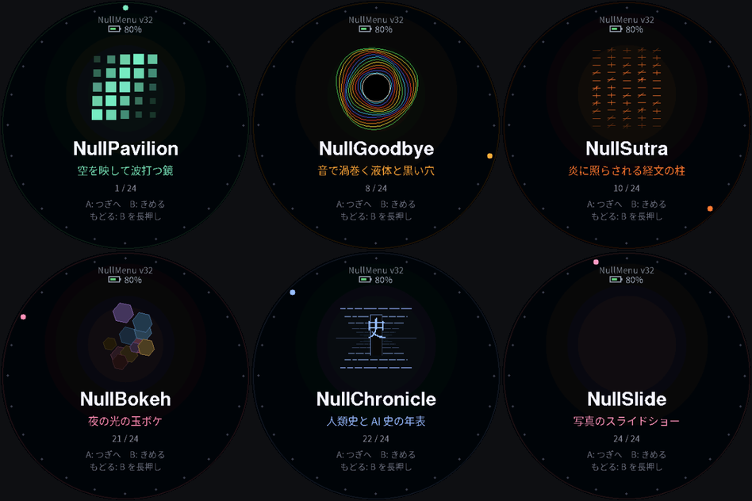

このリポジトリの作品を **29本ぜんぶ** 1つにまとめたランチャーです。
1回書き込めば、あとは本体のメニューから選ぶだけで、どの作品でも動かせます
(書き込むのは約2.9MB。StopWatch の 16MB のフラッシュに余裕で入ります)。
`NullLife_CoreS3_Nuru_v1` は `NullLife_Nuru_v6` と同じ作品の CoreS3 専用版なので、Nuru として1本に数えています。

- メニュー: **ボタンA** … つぎへ(長押しで前へ) / **ボタンB** … きめる / 左右になぞってもえらべます(1回なぞると1つ) / まん中の絵をタップでもスタート
- メニューに戻る: StopWatch は **ボタンB を1.5秒長押し**、CoreS3 系は **画面の左上のすみを1.5秒長押し**
- 作品の中のボタンやタッチの操作は、単体で書き込んだときと同じです
- 電池の残り: メニューの上に電池の絵と「78%」が出ます(充電中はそれも)。作品の最中は、残りが 15% 以下で充電していないときだけ、画面の下に小さな赤い電池の絵が出ます

作品を選ぶと本体が再起動して、その作品だけが動きます。
メモリは毎回まっさらな状態から始まるので、単体で書き込んだときと同じように動き、何度行き来しても減っていきません。

書き込むときは、ツールメニューの **Partition Scheme を「16M Flash (3MB APP/9.9MB FATFS)」** にしてください。
フォルダの中の `partitions.csv` が、実際の区切り方(プログラム 4MB と、GIF・写真の置き場 約 11.9MB)を決めます。メニューの名前と中身が少し違いますが、そのままで大丈夫です。
フォルダの中の `nm_common.h`・`null_usbdisk.h`・`mod_*.cpp` も一緒に必要です。Arduino IDE で開くとタブとして並びます(`partitions.csv` はタブには出ません)。

**NullMenu_v95 から、GIF・写真の置き場の場所と大きさが変わりました。** 前の版から書き込むと、本体にしまってあった GIF・写真は一度消えます(NullGif / NullSlide を初めて動かしたときに、置き場を整え直します)。元のファイルを手元に置いてから書き込んでください。

### NullEye

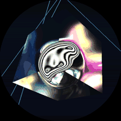

鏡の立方体。3つの面それぞれに違う景色が映り込み、膜が波打って像が液体金属のように流れます。
中央には、輪郭からぐねぐね波打つ白い眼。数秒おきにまばたきし、触るとその場でひとつ瞬きます。

### NullHorn

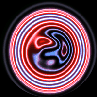

くぼみのふち寄りに赤と青の光のリングが重なり、内側は黒い鏡の池。
リングの映り込みが白熱した筋になって渦を巻きます。

### NullMirror

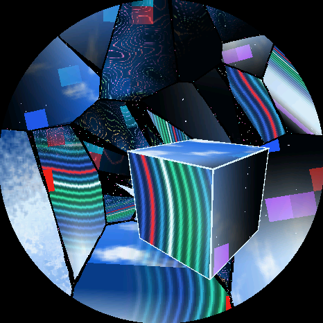

割れた鏡の部屋。後ろの鏡を触ると割れて広がり、手前の立方体は掴んで投げられます。

### NullPavilion

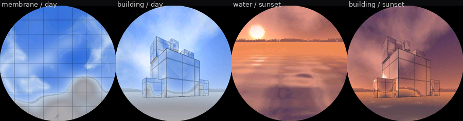
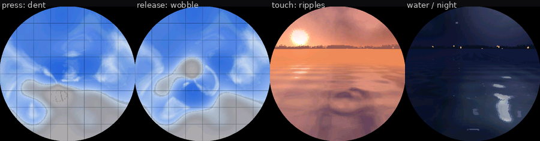

空と広場を映した鏡が、ゆっくり波打ちます。見え方は3つです。

- **鏡の膜** … 画面いっぱいの鏡の壁。押すとぬるっとへこみ、離すとぷるんと揺れもどる
- **鏡の建物** … 鏡の箱を積んだ建物を見上げる。触った箱の面が大きくうねる
- **鏡の水面** … 水銀のような水面。触ると波紋が広がり、ときどき雫も落ちる

ボタンA(CoreS3 はダブルタップ)で見え方、ボタンB(CoreS3 は電源ボタン)で空の時間帯(昼 / 夕暮れ / 夜 / くもり)を変えます。

### NullLife(ぬるっと版 / カール版)

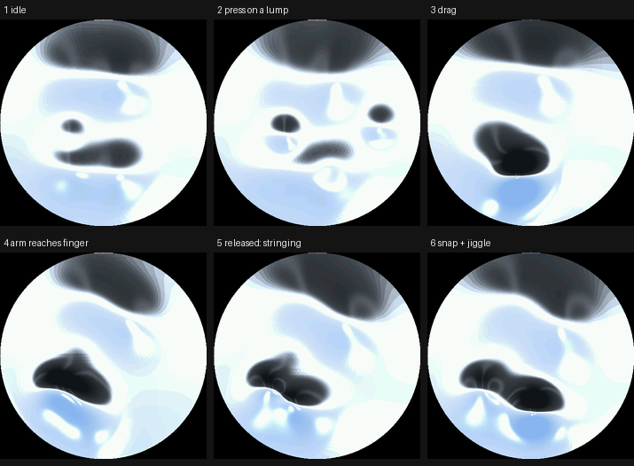

- **ぬるっと版** … 触るとぬるっとへこみ、ゆっくり戻る鏡の膜。鼓動に合わせて脈打つ
- **カール版** … 湧き出しも吸い込みもない渦の流れ(カールノイズ)で、膜の模様が流れ続ける

### NullVortex

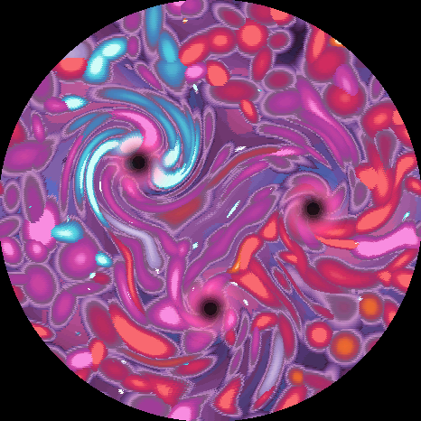

ランダムに動く渦が、まわりの色の塊を吸い込んでいきます。触ると渦を動かせます。

### NullSutra

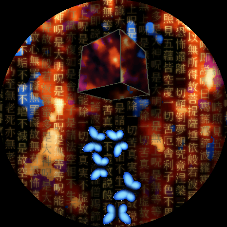

炎と青い光の雲の手前を、般若心経の文字の柱が流れます。
宙には鏡の立方体が浮かび、青い蝶が舞います。タップすると光の輪が広がり、通り道の文字が光ります。

文字は M5GFX に入っている明朝体(`lgfxJapanMincho_20`)で、起動時に描いて使います。
その明朝体に入っていない7字(蘊 埵 罣 礙 耨 藐 羯)だけは、Noto Serif CJK JP から作った小さなフォントをスケッチに入れています
(SIL Open Font License 1.1。[LICENSE_OFL_NotoSerifCJK.txt](LICENSE_OFL_NotoSerifCJK.txt))。
どの柱にも、5〜30 文字おきに「ﾇﾙ」が紛れ込んで流れてきます。
経文は玄奘訳の流布本で、古い経典なので著作権の対象ではありません。

### NullButterfly

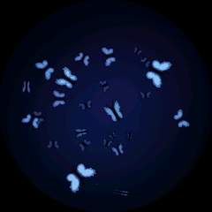

NullSutra の蝶だけを取り出して、たくさん飛ばした版。
奥・中・手前の3つの層に分かれた蝶が、左右に蛇行しながら、ふわっと浮き沈みして舞います。
ときどき羽を開いたまま滑空します。

- **数** … 5 / 15 / 25 / 50 / 100 匹
- **色** … 瑠璃 / 白銀 / 金 / 紅

### NullBodhisattva(null菩薩)

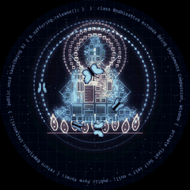

座った菩薩の姿が、大小の「クラスの箱」でできています。
大きな箱は小さな箱に分かれ(入れ子)、親と子の箱は継承の細い線でつながっています。

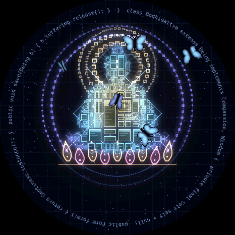
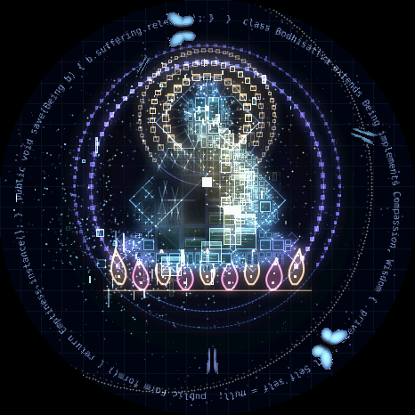

- 胸から外へ呼吸の波が広がり、箱がまとまったり分かれたりする
- 継承の線の上を、光の点(メッセージ)が胸から手足の先へ流れる
- 外周を、菩薩のクラス定義の文字がゆっくり回る
- 菩薩のまわりを蝶が舞う(5 / 10 / 20 匹)
- **触ると** … 光の輪と火花がはじけ、触った所の箱がまぶしく光りながら吹き飛ぶ。
  散った跡には継承の線だけの骨組みが見え、約15秒で元に戻る

**ほかの3つの場面**(StopWatch はボタンA、CoreS3 は画面の上半分をダブルタップで切り替え)

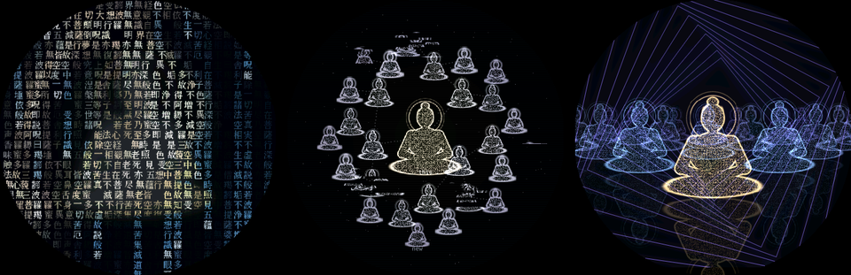

- **文字の菩薩** … 般若心経の文字が縦の列になって、上から雨のように降ってくる(先頭の字は白く光り、うしろは消えていく)。
  文字の列はそれぞれの速さでゆっくり下へ流れ、NullSutra と同じく 5〜30 文字おきに半角の「ﾇﾙ」が紛れ込んでいる。
  菩薩の形の所だけ文字が金色に灯り、降る文字の中に姿と光輪が浮かぶ。触ると波紋が広がり、通り道の文字が光ってゆれる
- **分かれる菩薩** … まっくらな中、まん中の菩薩(`this`)から、分身が走査線のように現れて(`new`)らせん状に増えていく。
  しばらくすると分身は乱れ(行がずれて赤と青緑に分かれ、抜ける)、ふちだけの抜けがらになって `null` と出て消える
  - 親が null になった分身は「迷子」になって、暗くふらふらする。ときどきまん中からゴミ集め(`GC`)の光がぐるっと回り、当たった迷子が null になる
  - 分身を長押しすると、それが `this` になって、親子の線がつなぎ直される(まん中を長押しすると戻る)
  - `this` からなぞって離すと、離した所に `new`。短いタップは、その近くに `new`
  - 本体を振ると `NullPointerException`。`this` のほかは全部 null になり、`this` から作り直す
  - 下の `heap 37/52` は、いま生きている分身の数。満杯が続くと GC が古いものから片付ける。色はほかの場面と同じく変えられる
- **映る菩薩** … 菩薩は1体だけ。見えない合わせ鏡に映った像が、左右の奥へどこまでも続く。
  本体を左右・上下に傾けると、奥の並びと鏡の枠がずれて、のぞき込む向きが変わる。タップすると金色の光が奥へ伝わっていく

操作(StopWatch): ボタンA 短押しで場面、長押しで色。ボタンB 短押しで明るさ、長押しで蝶の数。
色を変えても動きは止まりません。場面1・3の背景はすぐ、箱の場面の背景は動きながら少しずつ描き直して、描き終えたところで入れ替わります。

外周の文字やラベルは、DejaVu Sans Mono をもとに作った 6×12 ピクセルの小さな文字を、
スケッチの中に入れて使っています。場面1〜3の菩薩も画像ではなく、起動時に菩薩の形から計算して作っています。
降ってくる般若心経の文字は、NullSutra と同じく M5GFX の明朝体で描いています(般若心経は古い経典で、著作権の対象ではありません)
明朝体にない7字も NullSutra と同じ小さなフォント(Noto Serif CJK JP から作ったもの。SIL Open Font License 1.1)を使っています。

### NullGoodbye

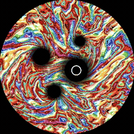

ある曲を聞いたイメージから作りました。
曲も画像もスケッチには入っておらず、模様はすべて起動時に計算して作っています。

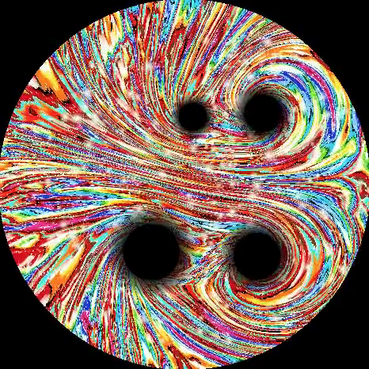
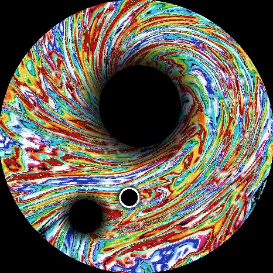

- 赤・橙・黄・緑・水色・青の帯が液体のように流れ、黒いブラックホールのまわりで渦を巻いて吸い込まれていく
- 帯は金属の管のようにつやつや光り、模様に混ざったラメと白い光の粒が、流れに乗って瞬きながら運ばれる
- **音に反応**: 本体のマイクで音が聞こえると、音の大きさとキックに合わせて流れ・渦・光が強くなる。
  聞こえないときは、本体の中の「振り付け」(この曲の流れ、約147 BPM)で動く
- **触ると**
  - タップ … そこに小さな渦が生まれて、光の粒がはじける
  - なぞる … 指の動きで流れができて、模様が運ばれる
  - 穴をつかんで動かす … ほかの穴にぶつけると、渦を巻きながら1つに結合する
  - 穴を長押し … まわりを吸い込みながら大きくなる
  - 穴を2回タップ … しぼむ。小さくなりすぎると、光をまき散らして消える
  - 穴のない所を長押し … 新しい穴が生まれて育つ(最大8個)
- **ボタン**(StopWatch): A 短押し … 振り付けを最初から / A 長押し … 色(Psyche / Ocean / Ember / Neon) / B … 明るさ
- **CoreS3 系**: 画面の上半分をダブルタップで振り付けを最初から、下半分で色。電源ボタンで明るさ

StopWatch のマイクを使うには **M5Unified 0.2.16 以降** が必要です
(それより古いと、マイクなしで振り付けだけで動きます)。

### メディアアートから受けたイメージの4つ(NullFloat / NullPond / NullPlasma / NullKintsugi)

作品の映像・名前・データは使わず、作品から受けたイメージだけで描いた習作です。

#### NullFloat(浮遊する光)

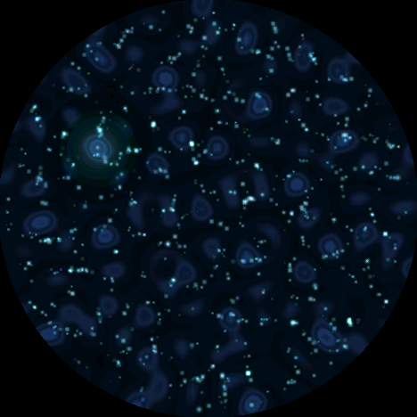
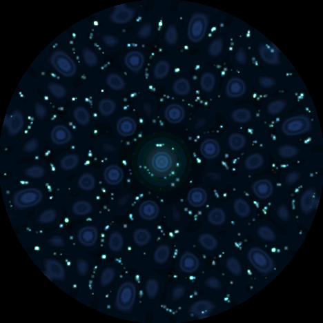

まわりの見えない音源の波が重なって、強いところと弱いところ(節)の模様ができ、光の粒が節に集まって浮かびます。
音源の位相がゆっくりずれると模様が組み変わり、粒も流れて集まり直します。

- **触ると** … 指の所に波が集まり(焦点)、粒が押しのけられる
- **傾けると** … 光の粒が低い方へ流れ、水平に戻すとまた節に集まる
- **ボタンA** … 音源の数(4 / 6 / 8) / **A 長押し** … 色(青 / 金 / 白) / **B** … 明るさ

#### NullPond(計算機自然の池)

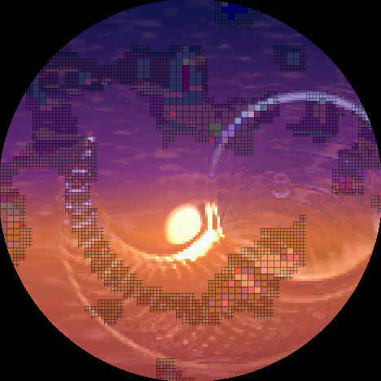
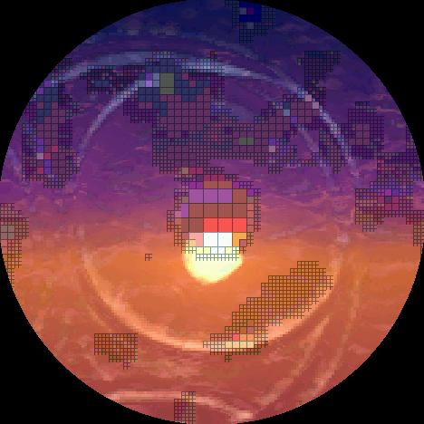

夕焼けを映す水面が、ところどころ色の段がついたピクセルのモザイクになり、またなめらかな景色へ溶けて戻ります。ときどき雨粒が落ちます。

- **触ると** … タップで波紋が広がり、指の下がピクセルに結晶して、しばらくすると溶ける
- **傾けると** … 映る空がずれ、低い方のふちから次々に波が立つ
- **ボタンA** … 空(夕焼け / 夜 / 夜明け) / **A 長押し** … デジタル化の多さ / **B** … 明るさ

#### NullPlasma(空中の光の点描)

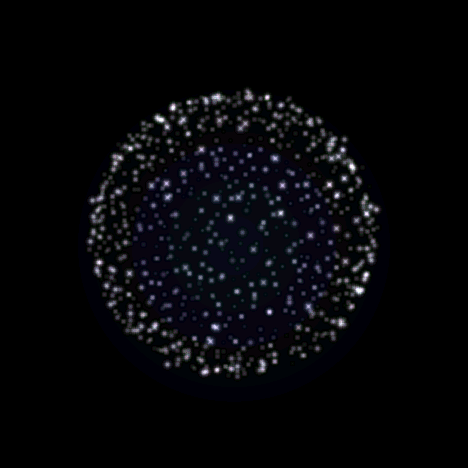
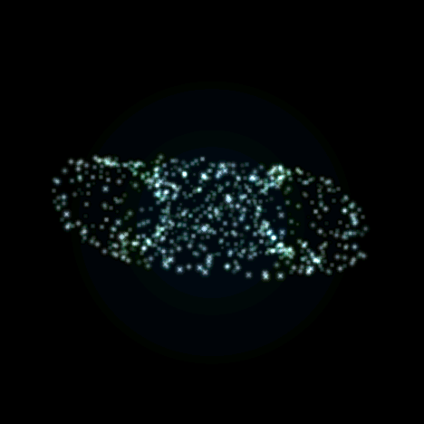

1000 の光の点が、回りながら 球 → トーラス → 蝶 → 二重らせん と組み変わります。点はプラズマのように瞬きます。

- **触ると** … ドラッグで回す / タップで点がはじけて散り、また集まる
- **傾けると** … 立体が傾けた方へ回る
- **ボタンA** … 次の形 / **A 長押し** … 色(紫 / 青白 / 琥珀) / **B** … 明るさ

#### NullKintsugi(金継ぎの計算)

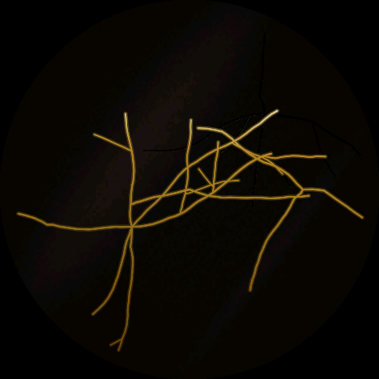
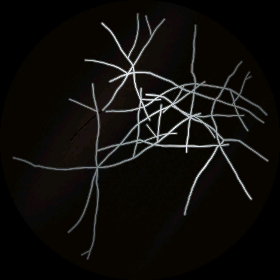

黒い漆の器を叩くとヒビが走り、少し遅れてそのヒビに金が流れこんで継がれていきます。
しばらく触らなくても自然にヒビが入り、器がいっぱいになると、ゆっくり消えて新しい器になります。

- **触ると** … タップした所からヒビが入る
- **傾けると** … ヒビに流れこむ金が低い方へ先に流れ、光の帯も低い方を向く
- **ボタンA** … どこかにヒビを入れる / **A 長押し** … 金継ぎ / 銀継ぎ / **B** … 明るさ

### null² から受けたイメージの4つ(NullInfinity / NullTwin / NullDrop / NullTiles)

これも、作品の映像・名前・データは使わず、イメージだけで描いた習作です。
上の4つと、下の2つも合わせた10個は、ブラウザでも試せます([docs/preview_10.html](docs/preview_10.html) をダウンロードして開く)。

#### NullInfinity(無限の鏡の部屋)

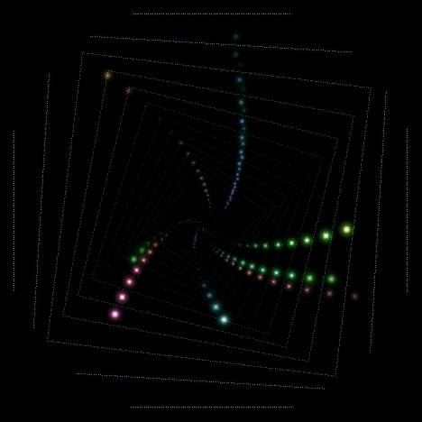
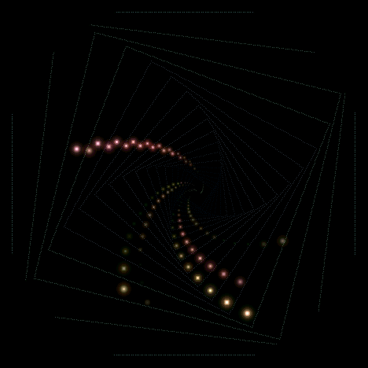

鏡のふちと光の点が、奥へ行くほど小さく、回りながらどこまでも続きます。

- **触ると** … 指の方へ部屋の奥がずれる / タップで光がひとつ増える
- **傾けると** … 部屋の奥(消失点)が傾けた方へずれる
- **ボタンA** … 光の色合い(虹 / 冷たい / 暖かい) / **A 長押し** … 光を並べ直す / **B** … 明るさ

#### NullTwin(デジタルの分身)

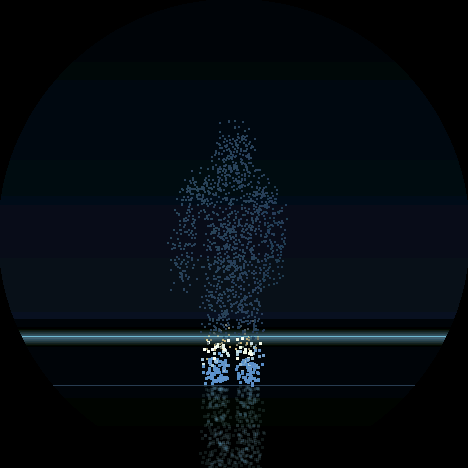
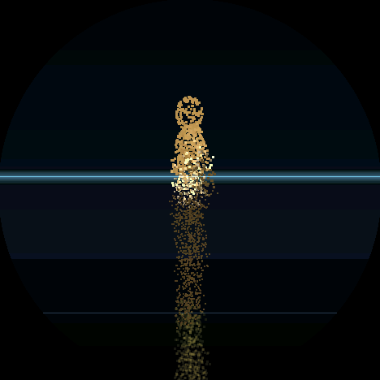

光の小さな立方体でできた人の姿。走査線が上がるときは下から組み上がり、下がるときは上から崩れます。床に鏡像が映ります。

- **触ると** … ドラッグで回す / タップで立方体がほどけて散り、また集まる
- **傾けると** … 左右に傾けると、分身がそちらへ回る
- **ボタンA** … 姿勢(立つ / 両手を広げる) / **A 長押し** … 色(青 / 金 / 白) / **B** … 明るさ

#### NullDrop(鏡の雫)

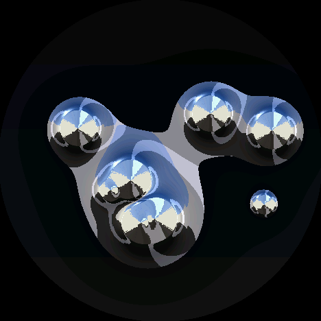
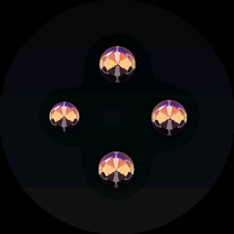

液体金属のような鏡の雫が、まわりの景色を映しながら、くっついたり離れたりします。

- **触ると** … ドラッグで近い雫を引っぱる / タップで小さな雫が生まれ、大きな雫に吸いこまれる
- **傾けると** … 雫が低い方へ転がって集まり、くっつく
- **ボタンA** … 雫の数(4 / 6 / 9) / **A 長押し** … 映る景色(部屋 / 夕焼け / 夜) / **B** … 明るさ

#### NullTiles(揺れる鏡のタイル)

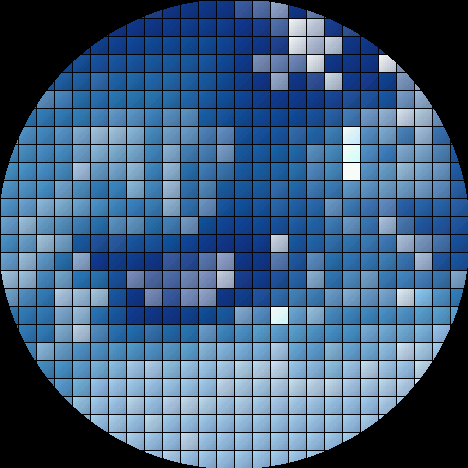
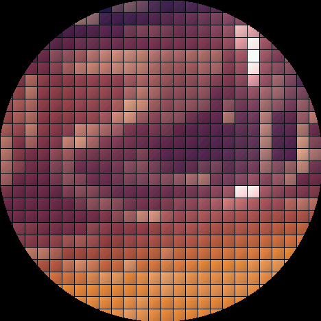

外壁のように並んだ鏡のタイルが、風の波でうねり、空と雲と太陽を映してきらめきます。

- **触ると** … タップした所から揺れが波紋のように広がる(押したままにすると続けて)
- **傾けると** … 手鏡をのぞくように、映る空がずれる
- **ボタンA** … タイルの細かさ / **A 長押し** … 空(昼 / 夕焼け) / **B** … 明るさ

### さらに2つ(NullZen / NullBokeh)

#### NullZen(計算機の枯山水)

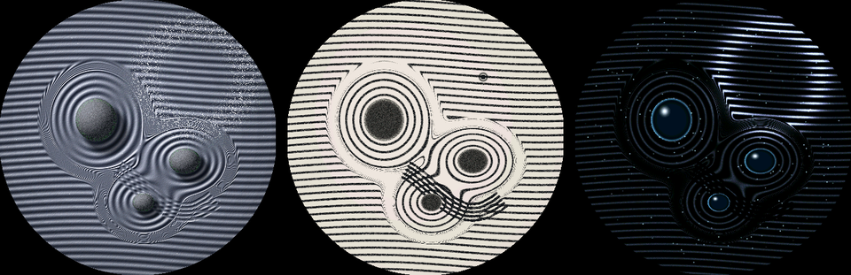

真上から見た枯山水。石のまわりは同心円の輪、その外はまっすぐの砂紋。砂は「高さの地図」で持っていて、見え方ごとに描き分けます。

- **月夜の砂** … 低い月の光が斜めに差し、砂紋の山と谷に陰ができる。石は影を落とし、砂粒がきらめく。月の光はゆっくり向きを変える
- **墨の庭** … 白い紙に墨で描いた枯山水。砂紋は筆の線、石は墨のにじみ。タップすると一滴の墨が落ちて輪が広がる
- **光る砂** … 暗い中で、砂紋の山だけが光の線になる。石は鏡の球で、まわりの光の線がゆがんで映る。光る砂粒がふわふわ漂う
- **触ると** … 砂をなぞると熊手の5本の溝が残り、風でゆっくり元に戻る / 石はドラッグで動かせる(離すと熊手が引き直す)/ 長押しで石を置く
- **ボタンA** … 見え方 / **A 長押し** … 砂紋の向き(横 / ななめ / 波)/ **B** … 明るさ

#### NullBokeh(焦点の光)

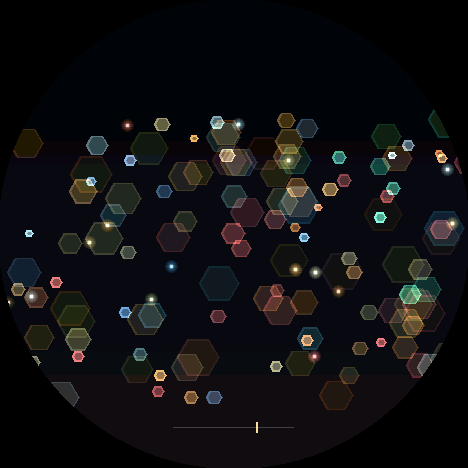
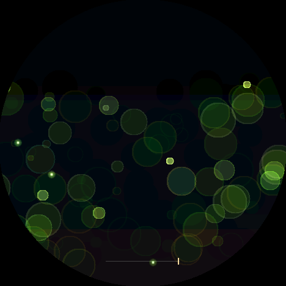

光が六角形の玉ボケになって浮かび、ピントがゆっくり前後に呼吸します。下の小さな目盛りが今のピントの位置です。

- **触ると** … タップした光にピントが合う / 上下にドラッグで手でピントを送る
- **傾けると** … 手前の光と奥の光が反対向きにずれて、奥行きが見える
- **ボタンA** … 景色(夜の街 / 雪 / 蛍) / **A 長押し** … ボケの形(六角 / 丸) / **B** … 明るさ

### NullChronicle(人類史と AI 史の年表)

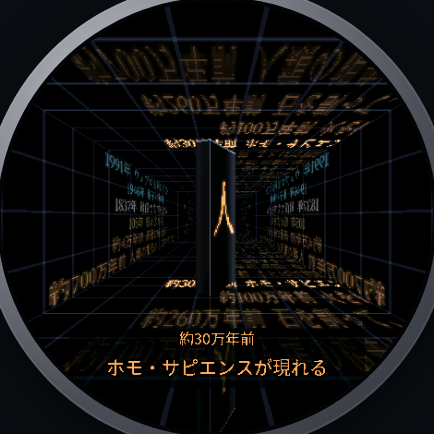 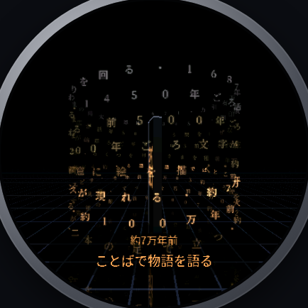

null² の「ダイアログモード」(鏡の部屋で、床と天井を年表のような文字が流れ、まん中にモノリスが立つ)から受けたイメージで作りました。
パビリオンの映像・音・文章は使っていません。年表の言葉は、このスケッチのために書いたものです。

見え方は2つあり、**ボタン B**(CoreS3 は電源ボタン)で「鏡の回廊 → 文字の塔 → おまかせ」と切り替えます(おまかせは1周ごとに入れかわります)。

- **鏡の回廊** … 床・天井・左右の壁の4面を年表が流れる、奥行きのある通路。パネルのつなぎ目の格子が奥へすぼまり、つやのある黒いモノリス(回ると光の帯がすべる)が床の鏡に逆さに映ります
- **文字の塔** … 年表の文字が、モノリスのまわりをらせんになって回りながら昇っていきます。下が太古、上が AI とこれから。奥の字はモノリスの裏にかくれ、床の鏡に塔が映ります
- まん中で黒いモノリスがゆっくり回り、いまの出来事を一字(立・火・文・印・電・算・網・話…)で光らせます。下に年と出来事が出ます
- 約700万年前の「二本の足で立つ」から、火、ことば、文字、印刷、蒸気、電気、計算機、ウェブ、深層学習、「AI と話す」へ。時代が進むほど流れが速くなります
- そのあとの「これから」の行(AI が AI をつくる / ことばの壁が消える / 身体をデジタルに写す / 自分ではない自分と話す / 記号を手放す)は、どれも想像です
- 最後は「ヌルへ」。文字が粒になってほどけ、まっくらになって、またはじめから(1周 2分たらず)
- **触ると** … 触った所の文字が、粒になって散ります。なぞると、なぞった所から散っていきます。回廊では床や壁の字に穴があき、塔では字がはじかれて、ゆっくり元に戻ります
- **傾けると** … 回廊はのぞき込む角度が変わり(低い方の壁が近づく)、塔は低い方へかたむいて、回る速さも変わります(向きが逆のときは TILT_FLIP_X / Y / SWAP)
- **ボタンA** … 次の出来事 / **A 長押し** … 前の出来事 / **B** … 見え方(CoreS3 は画面の右半分 / 左半分をダブルタップで次 / 前、電源ボタンで見え方)

### NullKaleido(ぬるぬる渦巻く光)

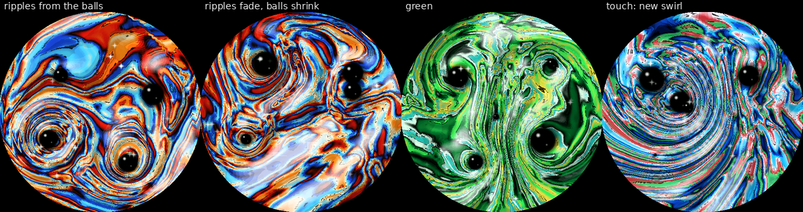

null² の中の、うずを巻いて流れる光の模様を見たイメージから作りました。パビリオンの映像は使っていません。模様はすべてプログラムで作っています。

- 光のマーブル模様がゆっくり流れながら、いくつものうずに巻きこまれます
- 表面はぬれたようなつやがあり、照りかえしがうずに合わせてぬるぬる動きます
- うずの中心には、黒いつやつやの玉が浮かんでいます。玉からは、うねうねとしたうねりが外へ広がっていきます
- うねりとうずがだんだん小さくなるのと一緒に、玉も小さくなって消え、別の所にまた新しい玉が生まれます
- 光の粒が、あちこちでふっと現れ、ふらふら動きまわりながら十字の光の筋を出してピカピカ光り、また消えます
- **触ると** … 触った所に新しいうずが生まれ、押しているあいだ強く巻きこみます(黒い玉も浮かびます)。離すと、ゆっくりほどけます
- **黒い玉を触ると** … うねりと玉が早めに小さくなって、やんわり消えていきます
- **ボタンA**(CoreS3 は電源ボタン)… 色(にじ / みどり / あお / あか / しろ)
- **ボタンB**(CoreS3 はダブルタップ)… うずの並びを変える(場所・大きさ・向きがランダムに変わります)

### NullGalaxy(立体の銀河・クエーサー・馬頭星雲)

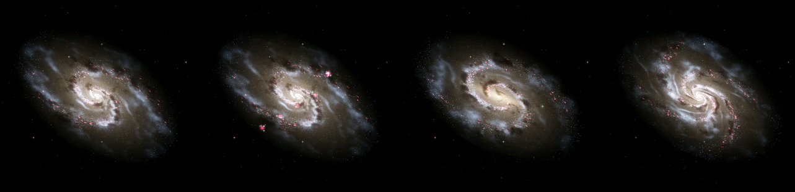

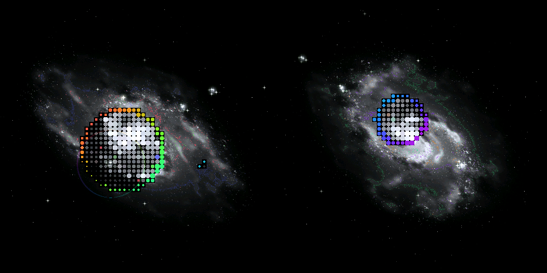

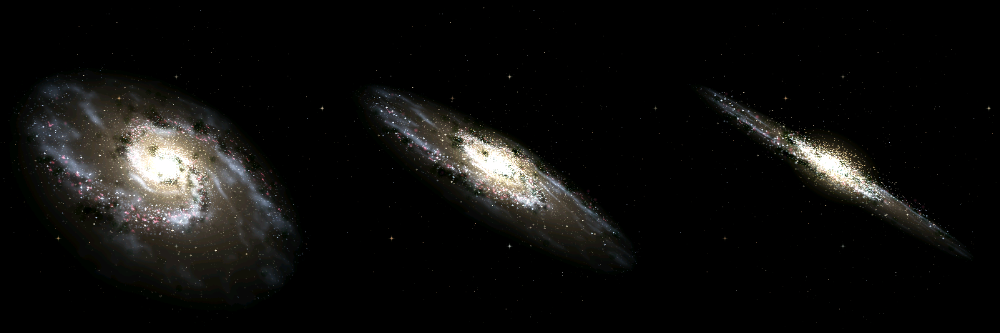

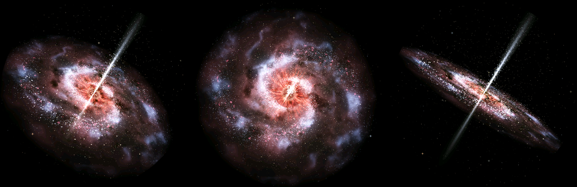

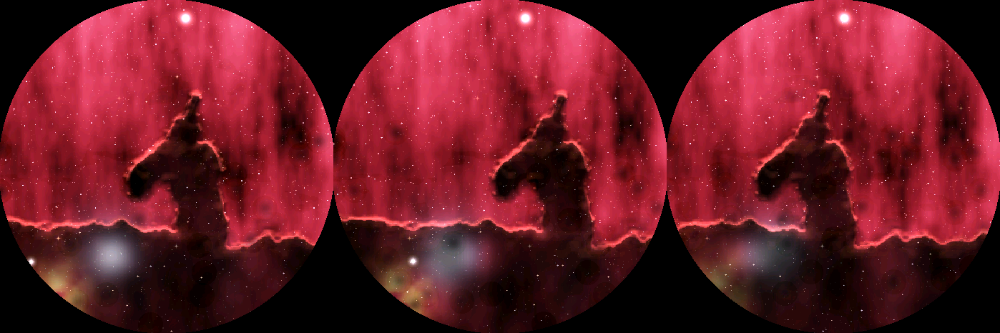

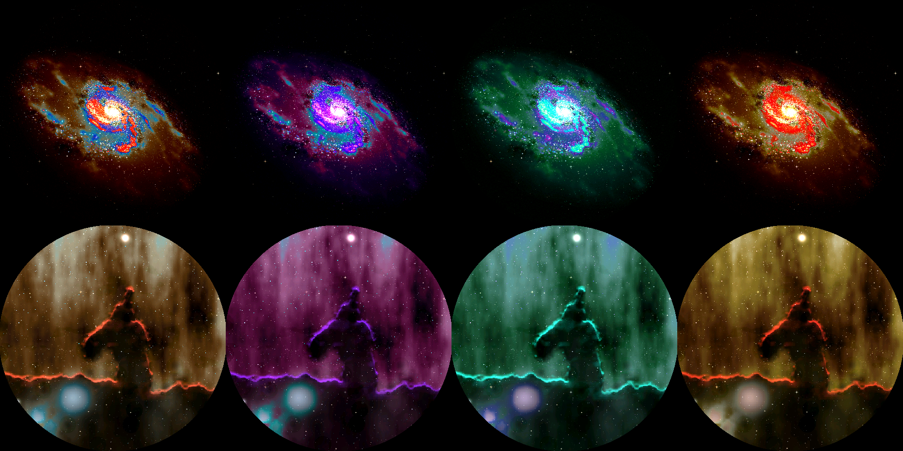

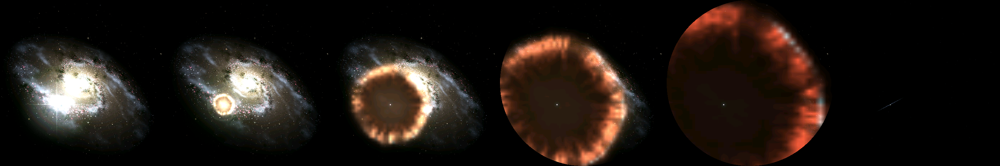

null² を見た印象から、宇宙の銀河と星雲を思い描いて作りました。写真や他の作品の画像は使っていません。銀河や星雲の絵は、起動時にプログラムで作っています(数秒かかります)。

- 金色に光る中心のふくらみと、青白い若い星が集まる渦巻きの腕。腕の内側には、黒〜茶色のちりの帯と、赤い星雲のかたまりがあります
- 銀河はゆっくり回ります。ときどき、どこかの星が超新星になって、まぶしく光ってから消えていきます
- まわりの星は奥行きがばらばらで、傾けると近い星ほど大きくずれます
- 見た目は6つです
  - **写真** … 上のとおりの、色のある銀河・星雲
  - **銀** … 色を抜いた、強い明暗の銀と黒。フィルムのような粒がちらつき、明るさのさかい目に、うすい虹の線がゆらめきます。まわりの星は、ふわふわ浮かぶ光の粒になります
  - **にじ / ネオン / オーロラ / ほのお** … NullKaleido のような鮮やかな色。明るさに合わせて色をつけ、色は時間とともに流れていきます(にじは NullKaleido と同じ6色、ネオンは紫〜マゼンタ〜水色、オーロラは青緑〜緑〜すみれ色、ほのおは赤〜オレンジ〜金)。馬頭星雲では、色をつけるのは後ろの壁だけで、手前の雲は黒い影、雲のふちは壁と反対側の色で光るので、どの色でも立体に見えます
- 立体です。近くから見ているので、手前のふちは大きく、奥は小さく見えます(回すと、手前と奥で動く速さがちがいます)
  - 円盤の星には上下の厚みがあり、手前の星ほど大きく明るく見えます。赤い星雲のかたまりと黒いちりの粒も、円盤から少し浮いています
  - 真ん中のふくらみは、横から見てもつぶれない玉です。横向きに近いと、円盤の向こう側の星はちりで暗くなり、ちりの帯が見えます
- **クエーサー**(4つ目の種類)… まん中の巨大なブラックホールがまぶしく光り、円盤に垂直に、細く長いジェットを上下に噴きます(根もとは細く明るく、先へ行くほど広がって薄れ、ところどころ金色の粒が光ります)。ブラックホールのまわりは暗い穴で、赤い筋が放射状に枝分かれして広がり、円盤はピンクのガス、腕には青い星のかたまり。傾けると円盤が寝て、ジェットが立って見えます。超新星爆発の光の殻が広がると、ジェットも消えます
- **馬頭星雲**(5つ目の種類)… 明るい赤に光る星雲の壁の前に、黒いちりの雲から馬の頭の形の影が突き出ています。上には壁を照らす明るい星、左下にはオレンジの炎のような星雲と青白く光る星雲。雲の表面は上の星に照らされて、でこぼこが浮かびます。後ろの壁・手前の雲・さらに手前に浮かぶ黒いちりの塊・星が別々の層になっていて、なぞったり傾けたりすると層が大きくずれ、馬の頭が壁から浮き出て見えます
- **タップすると** … 触った所に新しい星が生まれます(光の輪がひろがって、星雲と若い星のかたまりが残り、銀河と一緒に回りながら、だんだん消えます)
- **なぞると** … 銀河を立体のまま動かせます。横になぞると回り(はじくと、その速さでずっと回り続けます)、縦になぞると倒れます(上へなぞると横向きへ、下へなぞると真上から見る向きへ)。指をはなすと、倒した角度はゆっくり元に戻ります。馬頭星雲では、のぞく向きが変わります
- **指を当てたまま待つと** … はじいて回っているのが止まります(もとのゆっくりした回転にもどります)
- **傾けると** … 銀河を見る角度が変わります(手前・奥で真上から見たり横から見たり、左右で向きが回ります)
- **ボタンA**(CoreS3 は電源ボタン)… **超新星爆発で、銀河が null(無)になる**。腕の中の星がひとつ青白くふくらみ、まぶしく光ってまわりの銀河を照らします。熱いガスの火の玉がふくらみ、うすい殻になって広がります。殻は外へのびる炎の筋とともに、白 → オレンジ → 赤へと冷えていき、ふちには、ちぎれた青緑の衝撃波。円盤の星とガスは殻にはき寄せられて光り、殻の内側は銀河が消えて暗くぬけます。赤い残がいもちぎれて薄れ、残った中性子星の細い光が回りながら消えると、銀河はすべて消えて null(無)に。星ひとつない闇が少し続いたあと、まん中の小さな光から、銀河が渦を巻いて生まれ直します。生まれ直した銀河は、次の見た目(写真 → 銀 → にじ → ネオン → オーロラ → ほのお)になります。馬頭星雲では、ボタンA で見た目を切りかえます
- **ボタンA 長押し**(StopWatch だけ)… 回る速さ(1倍 / 4倍 / 16倍)
- **ボタンB**(CoreS3 はダブルタップ)… 種類(2本腕の渦巻き / 棒のある渦巻き / 腕の多いもじゃもじゃ渦巻き / クエーサー / 馬頭星雲)

### NullCloud(雲海と光輪)

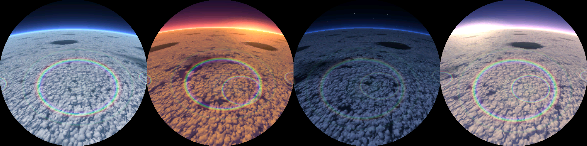

null² を見た印象から、飛行機の窓から見下ろす雲の海と、雲に映る虹の輪(光輪・ブロッケン現象のような光)を思い描いて作りました。写真や他の作品の画像は使っていません。雲の模様は、起動時にプログラムで作っています(少し時間がかかります)。

- 上は丸い地平線と、うすく光る大気の帯。下はどこまでも続く雲の海で、もこもこした積雲のつぶがびっしり並び、ゆっくり流れていきます。つぶごとに光の当たる側が白く、反対側は青みの灰色。遠くほど青白くかすみ、ところどころに雲の切れ間があります
- 雲の上に、虹の輪(光輪)がいくつか浮かびます。まん中がほんのり白く、細い虹の輪が2重(内側が青紫、外側が赤)。輪は雲の面に寝た丸なので斜めから見て楕円になり、手前の大きな輪が下の方に見えます。本物の光輪のように自分についてきて、雲は輪の下を流れていきます。向きや傾きを変えると、輪の形も見え方どおりに変わり、地平線にそってすべっていきます。雲の切れ間では消えます
- 時間帯は4つです
  - **朝** … 低い太陽が左の地平線からさして、雲は桃色がかった白。空は紺から桃・オレンジへ
  - **昼** … 白い雲と、青い大気の帯
  - **夕方** … 右に沈む太陽。雲はオレンジ、影は赤紫。地平線は赤から金
  - **夜** … 月明かりの青い雲と星空。光輪は淡い月の光輪
- **タップすると** … 触った所に、新しい光輪がふわっと生まれます(しばらくして消えます)
- **なぞると** … 横で見ている向きが回り、縦で見下ろす角度が変わります(はなすと、ゆっくり戻ります)
- **傾けると** … 左右で地平線が傾き、手前・奥で見下ろす角度が変わります
- **ボタンA**(CoreS3 は電源ボタン)… 時間帯(朝 / 昼 / 夕方 / 夜。2秒かけて色が移りかわる)
- **ボタンB**(CoreS3 はダブルタップ)… 雲の流れる速さ(1倍 / 3倍 / 8倍)

### NullSapiens(さようなら、ホモ・サピエンス)

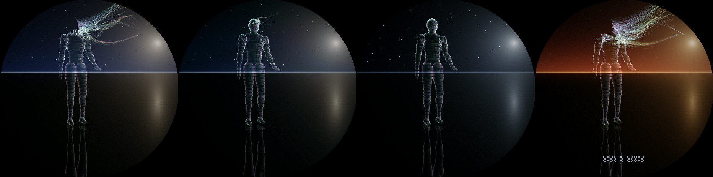

null² を見た印象から、「さようなら、ホモ・サピエンス」という言葉を思い描いて作りました。写真や他の作品の画像は使っていません。人の形・空・床は、起動時にプログラムで作っています(数秒かかります)。

- ほとんど黒い空と、地平線の細い光。右の奥に光の入り口。足もとは黒い鏡の床
- 人は、体を高さごとに輪切りにした細い輪郭線だけでできています(透けて見える光の彫刻)。縁ほど線が重なって明るく、光の当たる側はうすく虹色
- 頭の輪が、光の側でぷつりと切れて、1本の長い糸になってほどけます。糸は髪のように束になって、ゆるくうねりながら光の方へ流れていきます
- しばらくすると、糸は巻き戻るように頭へ戻り、また輪になります
- 床には、輪郭線の脚がさざ波でゆれて映ります
- 時間帯は3つです(**夜明け前** / **夜** / **夕暮れ**)
- **タップすると** … ほどけはじめます(ほどけているときは、巻き戻ります)
- **傾けると** … 左右で、糸の先が流れる向きが少し変わります。床のさざ波も少し強くなります
- **振ると** … 胸のあたりまで一気にほどけます。画面の下に「self = null;」。しばらくすると巻き戻ります
- **ボタンA**(CoreS3 は電源ボタン)… 時間帯(夜明け前 / 夜 / 夕暮れ。2秒かけて移りかわる)
- **ボタンB**(CoreS3 はダブルタップ)… 時間の速さ(1倍 / 2倍 / 0.5倍)

### NullSunset(夕凪の海)

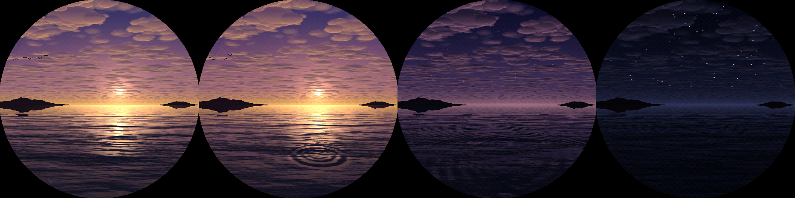

静かな夕方の海を、手のひらの丸い窓から眺める作品です。写真や他の作品の画像は使っていません。空も雲も波も、プログラムで描いています。

- 水平線まで続く静かな海と、左右の小さな島のシルエット
- 空には、もこもこした小さな雲がびっしり並ぶ「雲の天井」(NullCloud の雲の海を、下から見上げた感じ)。日の当たる側は金色に光り、反対側は紫がかった影。雲は流れていきます(速さはスケッチの先頭の CLOUD_SPEED)
- 日はゆっくり沈んでいきます。空は金色 → 夕焼け → 残照 → 青い時間 → 星空へ。しばらくすると、また明るくなって日がのぼります(1周 約2分40秒)
- 水面は、大きさと向きの違う小さな波がたくさん重なってできていて、波の面ごとに空を映します。雲も夕焼けも細かく砕けて映り、日の光は、波がきらきら反射してできる光の道になります。手前ほど空は映りにくく、暗い海の色になります
- 夕方には、ときどき鳥が横切ります。夜は星が出ます
- **海をタップすると** … そこから、しずくを落としたような波紋が広がります。海の上の丸なので、遠くほど小さく平たく見えます。先頭の輪がいちばん長く、うしろの輪ほど間がつまり、映った空と日の光が輪の形にゆれます
- **海をなぞると** … 指のあとに波紋が続いていきます
- **空をタップすると** … そこから鳥の群れが、手前を横切って飛んでいきます
- **空を左右になぞると** … 時間が前後に動きます(右へなぞると進む。画面の幅で 1/4 周。日をのぼらせたり、沈めたりできます)
- **傾けると** … 左右で見る向きが変わり(日と島が横へ動く)、手前・奥で水平線が上下します
- **ボタンA**(CoreS3 は電源ボタン)… 時間を進める(1/8 周ずつ。3秒かけて、ゆるりと移りかわります)
- **ボタンB**(CoreS3 はダブルタップ)… 時間の速さ(1倍 / 4倍 / 0.25倍)

### NullGif(GIF を流す)

本体にしまった GIF を、画面の大きさに合わせて流します。GIF は **PC から本体を USB メモリにして** 入れるか、**スマホから本体の Wi-Fi で** 送ります。

#### Wi-Fi で送る(スマホから送れます)

本体が自分で Wi-Fi を出して、スマホや PC のブラウザにページを出します。家の Wi-Fi の設定はいりません。
**Wi-Fi はふだん切ってあり**、送りたいときだけオンにします(電池のため)。**3分さわらなければ自動で切れます**。

1. 本体で作品を動かして、**ボタン B**(CoreS3 は電源ボタン)で設定を開き、「**Wi-Fi で受け取る**」を選ぶ
2. 画面の **QR コードをスマホのカメラで読む** → 本体の Wi-Fi「`Null2-xxxx`」に入る(パスワードは画面に出ている8けたの数字。本体ごとに決まっていて、毎回同じです)
3. **A を押す**(CoreS3 は画面をタップ)と、ページの QR コードに変わる → 読む(または `http://192.168.4.1` を開く)
4. ページで「GIF を選ぶ」→ スマホのアルバムから選ぶ(何枚でもまとめて送れます)
5. 終わったら **B**(CoreS3 は電源ボタン)で Wi-Fi を切る(切らなくても、3分で切れます)

- スマホは「インターネットに接続されていません」と出ますが、そのままで大丈夫です。ページが開かないときは、スマホのモバイルデータ通信をいったん切ってみてください
- 本体の Wi-Fi に入れるのは、画面のパスワード(QR コード)を知っている人だけです
- Wi-Fi の画面のあいだは、流すのは休みます(ページの「流す」「見せる」を押すと、数秒だけ見せてから Wi-Fi の画面に戻ります)

#### PC から USB メモリとして入れる

1. 本体で **NullGif** を動かし、USB ケーブルで PC につなぐ
2. **ボタン B**(CoreS3 は電源ボタン)で設定を開き、「**USB メモリになる**」を選ぶ
3. PC に USB メモリが出てくるので、**`gif` フォルダ** に GIF を入れる(いらない GIF はここで消す)
4. 終わったら、PC で **「取り出し」**(Windows はタスクバーの「ハードウェアを安全に取り外す」、Mac は Finder の ⏏)をする → 本体が再起動して、GIF を流しはじめます

- USB メモリになっているあいだは、本体は GIF を流しません。**ボタンを2回押す**(CoreS3 は2回タップ)と、取り出さずにやめることもできますが、PC がファイルをコピーしている途中だと中身がこわれることがあります。先に PC で「取り出し」をしてください
- PC にコピーしている途中でケーブルを抜くと、中身がこわれることがあります。そのときは、元のファイルを入れ直してください
- 書き込みの設定(USB Mode など)はそのままで大丈夫です。USB メモリになっているあいだは、シリアルモニタは切れます
- 名前は、ふつうの名前で大丈夫です(日本語や空白も可。ただし長すぎる名前と、`.` で始まる名前は一覧に出ません)
- USB メモリの中にある **`gif.cfg`**・**`slide.cfg`** は、NullGif・NullSlide の設定(明るさ・切り替え方など)を覚えておくファイルです。消すと、設定が最初の状態にもどります(壊れはしません)。本体の画面にも「*.cfg は設定」と出ます

- **ボタンA** … 次の GIF / **A 長押し** … 前の GIF / **B** … 設定(CoreS3 は画面の右半分 / 左半分をタップで次 / 前、電源ボタンで設定)
- 設定(ボタン B)の項目
  - **明るさ** … 1〜4
  - **終わったら** … **次の GIF へ**(1回流し終わったら次の GIF へ。短い GIF は5秒になるまでくり返してから) / **くり返す**(同じ GIF をずっと流す)
  - **名前の表示** … 下に出る「何番目か・名前・残りの容量」を、**手で替えたとき**(自動で次へ進んだときは出さない) / **いつも** / **出さない** から選ぶ
  - **向き** … **そのまま** / **さかさま**(GIF を 180 度回して流す)
  - **この GIF を消す** … いま流している GIF を本体から消す(B で消す / A でやめる)
  - **Wi-Fi で受け取る** / **USB メモリになる** … 入れ方
  - 明るさ・「終わったら」・「名前の表示」・「向き」は本体にしまわれるので、次に動かしたときもそのまま
- **入る数**: GIF は **64 個まで**。ただし容量(約 11.6MB)は写真と分け合うので、大きな GIF が多いときや写真が多いときは、それより少なくなります
- GIF は、フラッシュの **GIF・写真の置き場**(約 11.9MB、実際に使えるのは約 11.6MB)にしまいます。プログラムとは別の場所なので、GIF を出し入れしてもプログラムは消えません
- 丸い画面なので四角い GIF の四隅は切れます。466×466 くらいにしておくと、きれいで速く動きます(大きな GIF は、ほどく計算のぶん1秒に十数コマくらい)
- ※ CoreS3 でも動きますが、書き込むときに FATFS のある Partition Scheme を選んでください
- GIF を読む部分はスケッチの中に入っているので、ライブラリを足す必要はありません

### NullSlide(写真のスライドショー)

本体にしまった写真を、決めた時間ごとに切り替えて見せます。写真は **スマホから本体の Wi-Fi で**(送り方は NullGif と同じです)送るか、**PC から本体を USB メモリにして** 入れます。

#### Wi-Fi で送る(スマホから送れます)

本体が自分で Wi-Fi を出して、スマホや PC のブラウザにページを出します。家の Wi-Fi の設定はいりません。
**Wi-Fi はふだん切ってあり**、送りたいときだけオンにします(電池のため)。**3分さわらなければ自動で切れます**。

1. 本体で作品を動かして、**ボタン B**(CoreS3 は電源ボタン)で設定を開き、「**Wi-Fi で受け取る**」を選ぶ
2. 画面の **QR コードをスマホのカメラで読む** → 本体の Wi-Fi「`Null2-xxxx`」に入る(パスワードは画面に出ている8けたの数字。本体ごとに決まっていて、毎回同じです)
3. **A を押す**(CoreS3 は画面をタップ)と、ページの QR コードに変わる → 読む(または `http://192.168.4.1` を開く)
4. ページで「写真を選ぶ」→ スマホのアルバムから選ぶ(何枚でもまとめて送れます)
5. 終わったら **B**(CoreS3 は電源ボタン)で Wi-Fi を切る(切らなくても、3分で切れます)

- スマホは「インターネットに接続されていません」と出ますが、そのままで大丈夫です。ページが開かないときは、スマホのモバイルデータ通信をいったん切ってみてください
- 本体の Wi-Fi に入れるのは、画面のパスワード(QR コード)を知っている人だけです
- Wi-Fi の画面のあいだは、流すのは休みます(ページの「流す」「見せる」を押すと、数秒だけ見せてから Wi-Fi の画面に戻ります)

#### PC から USB メモリとして入れる

NullGif と同じ手順で、本体を USB メモリにして、**`slide` フォルダ** に写真を入れます(GIF と同じ置き場なので、`gif` フォルダも見えます)。

- USB メモリで入れられるのは、**600KB までの JPG だけ** です(.jpg / .jpeg。プログレッシブ JPEG は読めません。PNG や iPhone の写真(HEIC)は一覧に出ません)。カメラやスマホの写真は大きいことが多いので、**画面の大きさ(466 ピクセル四方くらい)に縮めて JPG で保存してから** 入れてください。大きな写真はとばされます
- PNG や iPhone の写真は、**Wi-Fi で送る** と、ページが自動で JPG に変えて送ります(USB メモリの画面にも、このことが出ます)
- スマホから **Wi-Fi で送るときは、ページが自動で画面の大きさの JPEG に縮めて** 送るので、そのままで大丈夫です(1枚 30〜80KB くらい。置き場に数百枚入ります)
- 順番は「送った順」のとき、名前の順になります

Wi-Fi のページで送るときは、**収め方** を選べます。

- **画面いっぱい** … 画面を埋めるように大きくして、はみ出す所は切る
- **全体を入れる** … 写真がまるごと見えるように小さくする(丸い画面では、まるの中に全部入るように。まわりは黒)

**スライドショーの設定**(ページのボタンでも、本体のボタン B で開く設定の画面でも変えられます。本体にしまわれるので、次に動かしたときもそのまま)

| 項目 | 選べるもの |
|---|---|
| 切り替え方 | パッと / フェード(ふわっと混ざる) / スライド(横にすべる) / ハート(いまの写真がハートの形に小さくなりながら消えていく) |
| 1枚の時間 | 3秒 / 5秒 / 10秒 / 15秒 / 30秒 / 45秒 / 1分 / 手動(ボタンで送る) |
| 順番 | 送った順 / ランダム |
| 形 | そのまま / ハート(写真の上にかぶせる窓の形。「そのまま」は画面いっぱいに見せる。写真そのものは変わりません) |
| ハートの色 | 黒 / ピンク / 赤 / むらさき / 水色 / 白(形が「ハート」のときのまわりの色と、切り替え方「ハート」のふちの色。本体の設定だけで変えられます) |
| 向き | そのまま / さかさま(写真を 180 度回して見せる。ハートの形も一緒に逆さになります。本体の設定だけで変えられます) |
| 明るさ | 1〜4 |
| さわって送る | オフ / なぞる / タップ / 両方(はじめは「両方」)。1枚の時間が自動のときも、画面を **左へなぞる・右半分をタップ** で次の写真、**右へなぞる・左半分をタップ** で前の写真。手で送ると、自動の時間はそこから数え直します(CoreS3 ではオフにはなりません) |

- **ボタンA** … 次の写真 / **A 長押し** … 前の写真 / **B** … 設定(設定の中では A で次の項目、B で変える、A 長押しでとじる)
- 設定には、上の表のほかに **この写真を消す**(いま見せている写真を本体から消す。B で消す / A でやめる)、**Wi-Fi で受け取る**、**USB メモリになる** があります
- **入る数**: 写真は **400 枚まで**。ただし容量(約 11.6MB)は GIF と分け合うので、GIF が多いときや写真が大きいときは、それより少なくなります(ふつうの写真なら 120〜300 枚くらい)
- CoreS3 は、画面の右半分 / 左半分をタップ(または左 / 右へなぞる)で次 / 前、電源ボタンで設定(設定の中は項目をタップで変える)
- Wi-Fi のページには本体の写真の一覧と **残りの容量 / 全体の容量** が出て、写真を選んで見せたり、消したり(全部消すことも)できます
- ※ CoreS3 でも動きますが、書き込むときに FATFS のある Partition Scheme を選んでください
- JPEG を読むのは M5GFX の機能(drawJpg)なので、ライブラリを足す必要はありません

---

## 動かすには

### 必要なもの

- **ボード**: M5Stack StopWatch(丸い 466×466 AMOLED / ESP32-S3R8)
  または CoreS3 / CoreS3 Lite / CoreS3 SE(320×240)
- **Arduino IDE 2.x**
- ボードマネージャー **M5Stack 3.3.7 以降**
  (環境設定の「追加のボードマネージャのURL」に
  `https://static-cdn.m5stack.com/resource/arduino/package_m5stack_index.json`)
- ライブラリ **M5Unified 0.2.16 以降** と **M5GFX 0.2.21 以降**(最新版をおすすめします)

### 手順

> 📘 **はじめての人は [HOW_TO_WRITE.md(書き込み方)](HOW_TO_WRITE.md) を見てください。** Arduino IDE の入れ方から、StopWatch への書き込み、うまくいかないときの直し方まで、1つずつ書いてあります。

かんたんな流れ:

1. このリポジトリをダウンロード(緑の **Code** → **Download ZIP**)して展開
2. 使いたいスケッチのフォルダごと Arduino のスケッチブックに置く
   (全部まとめて入れたいときは **NullMenu_v97** だけで OK。29本がメニューから選べます)
   (フォルダ名とファイル名が同じである必要があります: `NullEye_v4/NullEye_v4.ino`)
3. Arduino IDE で開き、ボードに **M5StopWatch**(CoreS3 系なら **M5CoreS3**)を選ぶ
   StopWatch では、ツールメニューの **PSRAM を「OPI PSRAM」** にしてください
   (なっていないと、起動時にメモリが足りずに止まります。フラッシュは 16MB です)
4. ツールメニューで **Partition Scheme** を「16M Flash (3MB APP/9.9MB FATFS)」にする(NullMenu_v97 / NullGif / NullSlide のとき。実際の区切り方はフォルダの中の `partitions.csv` で決まります)
5. 書き込む

### 操作

傾きで動く9本(NullFloat 〜 NullBokeh。NullZen は除く)と NullChronicle、NullGalaxy、NullCloud、NullSapiens、NullSunset、null菩薩の「映る菩薩」は、**本体を傾けても動きます**(StopWatch の傾きセンサー)。
傾きの向きが逆に感じるときは、スケッチの冒頭の「傾き」のまとまりにある `TILT_FLIP_X` / `TILT_FLIP_Y` / `TILT_SWAP` を `true` にしてください。
(StopWatch では、傾きセンサーが画面に対して 90 度回ってついているので、自動で読みかえています。`TILT_STOPWATCH_FIX` を `false` にすると読みかえません)
(NullMenu_v97 では、`mod_nullfloat.cpp` などそれぞれの作品のファイルの中にあります)
作品を始めたときの持ち方を「水平」とみなします。同じ角度でしばらく持っていると、ゆっくりそこが新しい水平になります(何もしていないのに片側へ寄っていかないように)。
この時間は `TILT_RELEVEL`(秒。0 にすると、始めたときの姿勢のまま)で変えられます。
Serial モニタに `tilt: x … y …` が出るので、右を下げたときに x が +、手前(画面の下)を下げたときに y が + になっていれば正しい向きです。
傾きセンサーがない機種では、自動で傾きなしの動きになります。

StopWatch はボタンA・B、CoreS3 系はダブルタップと電源ボタンで操作します。
それぞれの操作は、各スケッチの先頭のコメントに書いてあります。

Serial モニタ(115200)に、版の名前と `fps:` が出ます。

### 確認したこと

NullMenu_v97 は、PC 上で次のことを確かめています。
NullCloud より前の26本それぞれを、メニューから動かしたときと単体で動かしたときとで、
同じ操作(なぞる・タップ・長押し・ボタン)を300フレーム分与えた画面が、丸い画面・四角い画面とも1ピクセルも変わらないこと。
メニューからの起動、戻る操作、作品が途中で止まったときにメニューへ戻ることも、AddressSanitizer をかけて確かめています。
NullCloud は、メニューから起動して動くこと・時間帯の切りかえ・戻る操作を、ブラウザ版(同じ C++)で確かめています。
NullSapiens は、メニューから起動して動くことをブラウザ版で、丸い画面・四角い画面で動くこと(タップ・振る・時間帯の切りかえ)を PC 上で AddressSanitizer をかけて確かめています(実機ではまだ試していません)。
NullSapiens v3 は、起動時に体の輪切りの輪郭を求め、腰から下は光の絵に、腰から上は点ごとに「光への流れの道すじ」を覚えておきます。コマごとには、ほどけ具合に応じて道すじをたどって線をつなぐだけです。PC で数えた1コマの命令数は約 10M(2つのコアの合計)です。
NullSunset は、メニューから起動して動くことをブラウザ版で、丸い画面・四角い画面で動くこと(タップ・なぞりの波紋、鳥、空をなぞって時間を動かす、時間の切りかえ)を PC 上で AddressSanitizer をかけて確かめています(実機ではまだ試していません)。空と海は1点おきに計算して、あいだはまん中の色にしています。海に映る空は、コマのはじめに2つのコアで小さく描いておいたものから引きます。PC で数えた1コマの命令数は v2 より約2割多く、実機では 1秒に 20〜25 コマくらいの見込みです。
NullCloud は、v1 を実機で動かしたら 5fps ほどだったので、v2 で速くしました(実機 v2 で昼 約14fps)。PC で数えると、1コマの命令数は v1 の約 6 割、
PSRAM の読み出しがキャッシュから外れる回数は約 1/10 です(雲の絵を 4x4 点ずつまとめて並べ、遠くは縮めた絵から引く)。
絵は v1 とほぼ同じで、遠くの雲のちらつきが少し減っています。v3 では、雲の面と空を 2x2 点に1回だけ計算して、あいだをなめらかにつなぐようにしました(地平線の近くだけは1点ずつ)。
PC で数えた1コマの命令数は v2 の約 57%(v1 の約 35%)です。また、手前・奥に傾けたときの効きを約3倍にしました。
v6 では、雲を積雲のつぶでできた雲の海に作りかえ(起動時に、つぶを丸い山の形で置いて高さの絵を作り、その傾きで光の当たり方を決める)、光輪を雲の面に寝た楕円に戻しました(輪の中心での見え方で形を決めるので、輪の太さはどこでもそろう)。
v5 では、光輪を本物に近づけ(画面の上で真ん丸、決まった方向)、向きによって PSRAM の読み出しが増えるのを抑え、Serial に1コマの時間の内わけ(`time:` の行)を出すようにしました。
v4 では、時間帯を変えても止まらず、2秒かけて色が移りかわるようにしました(雲の模様には色ではなく「濃さ・陰・切れ間」の番号を入れておき、小さな色の表だけをまぜる)。
朝・夕方の太陽の照り返しは太陽の近くだけで計算し、帯は2つのコアのうち空いた方が描くようにしました。
NullCloud・NullGalaxy とも、同じ角度で持ち続けると、そこをゆっくり「水平」にし直します(大きく傾けているあいだは、し直しません)。
NullGalaxy v13 は、銀河・馬頭星雲の絵を作る計算を速くしました(exp・pow・atan2 などを速い近似に、ノイズを内蔵メモリの格子から)。
PC で数えた命令数は、銀河が約 6 割、馬頭星雲が約 5 割です(実機 v12: 銀河 4.7〜5.0秒、馬頭星雲 3.6秒)。
NullGalaxy v13 では、銀河の腕・円盤などゆっくり変わる所を半分の細かさで作り、仕上げも2つのコアで分けました(見込み: 2.5〜3秒)。
NullGalaxy v14 では、ボタンA で超新星爆発が起き、銀河が null(無)になってから生まれ直すようにしました。v15 では、爆発を本物の超新星の残がい(網状星雲など)に近い見た目にしました。PC 上で AddressSanitizer をかけて確かめています(実機ではまだ試していません)。v17 では、種類にクエーサーを足しました。絵を作るときだけ使う関数を小さく作るようにして、プログラムは v16 より小さくなっています。また、超新星爆発を作り直しました(真っ黒な輪でくり抜くのをやめて、火の玉 → 厚い殻 → 赤い残がい → null へ)。模様は爆発のはじめに表にしておき、ガスはぼやけた光なので数点おきに計算して、あいだをなめらかにつなぎます。PC で数えた描く命令数は、ふだんの 1.15〜1.26 倍(前の爆発は 1.4〜1.5 倍)。v18 では、実機で爆発の後半が 11.4 fps だったので、殻が大きくなったときの計算の間隔を少し広げました。v20 では、爆発の光がモヤモヤしていたので、中に残る火の玉の光と殻の外ににじむ光をなくし、殻をうすく、炎の筋の明るさの差を大きくして、ふちに青緑の衝撃波を足しました(計算の量は v18 と同じ)。また、殻が円盤の星とガスをはき寄せて光らせる所が、書きまちがいで出ていなかったのを直しました。
また、銀河の絵を 4行ずつの帯・縦4点ずつに並べ替えました。前は、銀河の回る向きによって PSRAM の読み出しが約 8 倍に増え、ときどきカクカクしていました。
また、各作品が速い内蔵メモリに置くもの・PSRAM に置くものが、単体で書き込んだときと変わらないことも確かめています。
NullMenu v95 では、メニュー本体がいつも使う内蔵メモリを約 7.6KB 減らしました(NullGalaxy・NullSutra・NullKaleido の小さな表を、共通の置き場 NM_ARENA へ移した)。null菩薩は内蔵メモリをいちばん多く使うので、その分の余裕になります。null菩薩が「Memory error」で止まったときは、画面を消して赤い字で出し、Serial に起動時の内蔵メモリの空きを出すようにしました。

すべてのスケッチを、Arduino IDE と同じ前処理(関数の宣言を自動で足す ctags)を通したうえで、Arduino ESP32 3.3.7 + M5Unified 0.2.25 + M5GFX 0.2.32 で、
ESP32-S3(OPI PSRAM。StopWatch 相当)と M5CoreS3 の両方に向けてコンパイルできることを確かめています。
StopWatch では、帯を描くごとに丸の中にかかる幅だけを画面へ送るようにしています
(M5GFX が PSRAM にためて 468×468 の四角ごと送るのを避けるため。CoreS3 では今までどおり直接送ります)。
この変更の前後で、画面に出る絵が1ピクセルも変わらないことを、PC 上で確かめています。
実機での動作は、まだ全部は確かめられていません。うまく動かないときは Issue で教えてください。

---

## しくみ

ESP32-S3 でフルスクリーンをぬるぬる動かすために、どのスケッチも同じ骨格でできています。

- **重い計算は1フレームに1回だけ**。色は「色の表」や「まわりの景色の絵」に焼いておき、
  1ピクセルあたりは足し算と表引きで済ませます
- **膜のうねり**は 8px 間隔の粗い格子の上だけで計算し、ピクセル間は整数の足し算で補間します
- **画面は8行ずつの帯**に分け、2つのコアが交互に描いて、描けた帯から順に DMA で送ります
- CoreS3 では、横幅いっぱいの正方形のうち、画面に見えている帯だけを描きます

各スケッチの冒頭に「調整用」のまとまりがあります。
うねりの大きさ、渦の速さ、蝶の数、戻るまでの時間などは、そこの数値だけで変えられます。

---

## ライセンス

**個人で楽しむ範囲に限り**、自由に使って、自由に改造してください。
詳しくは [LICENSE](LICENSE) を見てください。

- ✅ 個人で楽しむ / 学ぶために読む / 自分の手元で改造する
- ✅ ブログ・SNS・動画・記事での紹介(スクショや動画の掲載も歓迎。リンクを添えていただけると嬉しいです)
- ✅ GitHub 上での fork(ライセンスファイルはそのまま残してください)
- 📩 GitHub の外へのコード配布、展示・上映、学校の課題やコンテスト、
  販売・有償頒布、書き込んだ機器の販売、有償の製品・サービス・講座への組み込み

📩 は禁止ではなく「ひとこと聞いてください」という意味です。
ご連絡いただければ、個別に許可することがあります。
