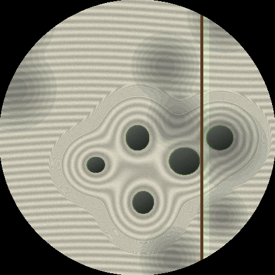
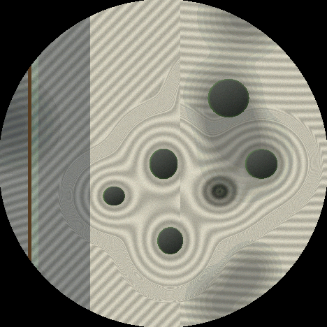

# Unofficial null²-inspired sketches for M5Stack

> **お断り(非公式)**
> これは **ファンによる非公式の個人作品** です。
> パビリオン「null²」とその制作者、および万博の関係者・権利者とは一切関係がなく、
> 許諾も受けていません。公式の配布物でも、公式の移植版でもありません。
> 実物の映像・音声・設計データ・プログラムは一切使っておらず、
> 画面に出るものはすべて、その場で計算して描いています。
> リポジトリ名の "null2" は、着想元を示すためだけの表記です。

大阪・関西万博 2025 のパビリオン **null²** を見て、
あの「生きている鏡」を手のひらの上で動かしたくて書いた Arduino スケッチ集です。

丸い 466×466 の AMOLED を持つ **M5Stack StopWatch** が主なターゲットですが、
どのスケッチも **CoreS3 / CoreS3 Lite / CoreS3 SE**(320×240)でも動きます。
画面の形を見て、自動で切り替わります。

### ▶ ブラウザで試す

**https://laughingmanjp.github.io/nullnull-Imitation-tool/**

本体がなくても、24作品ぜんぶをメニューから選んで動かせます(NullGif の GIF や NullSlide の写真も、エミュレータの中へ入れて試せます)。
本体に書き込むのと同じ C++ を WebAssembly にしたもので、画面・ボタンA/B・タッチ・傾き(パッド、またはスマホの傾きセンサー)・マイク(NullGoodbye)が使えます。
StopWatch(丸い画面)と CoreS3(四角い画面)を切り替えられます。速さは本体とは違います。

GIF を本体へ送るページは **https://ユーザー名.github.io/unofficial-null2-m5stack/gif.html**(NullGif 用)、
写真を本体へ送るページは **https://ユーザー名.github.io/unofficial-null2-m5stack/slide.html**(NullSlide 用)です。どちらも PC の Chrome / Edge で開きます。

**URL をクリックしたらすぐエミュレータが開くようにする手順**(最初に1回だけ)

1. リポジトリを **Public**(公開)にする(無料のアカウントでは、公開しているリポジトリでないと GitHub Pages が使えません)
2. リポジトリの **Settings → Pages** で、Source を「Deploy from a branch」、Branch を `main`、フォルダを `/docs` にして **Save**
3. 数分待つと、上の URL でエミュレータが開けるようになります(Settings → Pages の上に、公開された URL が出ます)
4. リポジトリのトップページの右側にある **About の歯車** を押して、**Website** に上の URL を入れて Save。
   リポジトリのページの右上に URL が出るので、そこをクリックするだけでエミュレータが開きます
5. この README の `ユーザー名` の所を、自分の GitHub のアカウント名に書き換える

ページの作り直しかたは [tools/web-emulator](tools/web-emulator/) にあります。

---

> 📘 **パソコンから StopWatch に書き込む方法は [HOW_TO_WRITE.md(書き込み方)](HOW_TO_WRITE.md)** にくわしく書いてあります。

## 入っているもの

フォルダ名の `_v1` `_v2` … は版の番号です(数字が大きいほど新しい)。
このリポジトリには、それぞれの最新版だけを置いています。

| スケッチ | 何が映るか | CoreS3 |
|---|---|---|
| [**NullMenu_v32**](NullMenu_v32/) | **24本ぜんぶ入り**。1回書き込むだけで、本体のメニューから好きな作品を選んで動かせる | ○ |
| [**NullEye_v4**](NullEye_v4/) | 宙に浮かぶ鏡の立方体と、その中央でうねる眼 | ○ 全画面 |
| [**NullHorn_v4**](NullHorn_v4/) | ラッパ形のくぼみの奥で光る、赤と青のリング | ○ 全画面 |
| [**NullMirror_v5**](NullMirror_v5/) | 割れた鏡の部屋と、浮かぶ立方体 | ○ 全画面 |
| [**NullPavilion_v4**](NullPavilion_v4/) | 空と広場を映す鏡が波打つ。見え方は「鏡の膜」「鏡の建物」「鏡の水面」の3つ | ○ 真ん中に正方形 |
| [**NullLife_Nuru_v6**](NullLife_Nuru_v6/) | ぬるっと動く鏡の膜 | ○ 全画面 |
| [**NullLife_CoreS3_Nuru_v1**](NullLife_CoreS3_Nuru_v1/) | 上の CoreS3 専用版 | CoreS3 専用 |
| [**NullLife_Curl_v7**](NullLife_Curl_v7/) | 鏡の膜 + 見えない渦の流れ(カールノイズ)。膜の模様が大理石のように流れる | ○ 全画面 |
| [**NullVortex_v5**](NullVortex_v5/) | うねる光の膜に渦が空いて、まわりの塊を吸い込んでいく | ○ 全画面 |
| [**NullSutra_v8**](NullSutra_v8/) | 炎の雲に照らされて、般若心経の文字の柱が流れる暗い鏡の部屋 | ○ 全画面 |
| [**NullButterfly_v6**](NullButterfly_v6/) | 暗い空に、たくさんの蝶がゆらゆら舞う(5〜100匹) | ○ 全画面 |
| [**NullBodhisattva_v10**](NullBodhisattva_v10/) | オブジェクト指向菩薩。クラスの箱でできた菩薩。触ると、はじけて散る | ○ 全画面 |
| [**NullGoodbye_v13**](NullGoodbye_v13/) | サイケデリックな液体の模様が、黒いブラックホールへ渦を巻いて吸い込まれる。音に反応し、穴は触って育てたり結合したりできる | ○ 全画面 |
| [**NullFloat_v6**](NullFloat_v6/) | 見えない音の波の「節」に、光の粒が集まって浮かぶ | ○ 全画面 |
| [**NullPond_v6**](NullPond_v6/) | 空を映す水面が、ところどころピクセルに「デジタル化」して、また自然へ溶けて戻る | ○ 全画面 |
| [**NullPlasma_v6**](NullPlasma_v6/) | 空中の光の点描。光の点が、回りながら球・トーラス・蝶・二重らせんに組み変わる | ○ |
| [**NullKintsugi_v6**](NullKintsugi_v6/) | 黒い漆の器を叩くとヒビが走り、そこに金が流れこんで継がれていく | ○ |
| [**NullInfinity_v6**](NullInfinity_v6/) | 合わせ鏡の部屋。鏡のふちと光の点が、奥へ奥へと回りながら無限に続く | ○ |
| [**NullTwin_v6**](NullTwin_v6/) | 光の立方体でできた人の姿が、走査線で組み上がっては崩れていく | ○ |
| [**NullDrop_v6**](NullDrop_v6/) | 液体金属のような鏡の雫が、景色を映しながらくっついたり離れたりする | ○ |
| [**NullTiles_v6**](NullTiles_v6/) | 外壁のような鏡のタイルが風でうねり、空を映してきらめく | ○ 全画面 |
| [**NullZen_v6**](NullZen_v6/) | 計算機の枯山水。タップで石を置くと、熊手が砂紋を引き直す | ○ 全画面 |
| [**NullBokeh_v6**](NullBokeh_v6/) | 夜の光が六角形の玉ボケになって浮かび、ピントがゆっくり呼吸する | ○ 全画面 |
| [**NullChronicle_v7**](NullChronicle_v7/) | 人類の歴史とこれからの AI の年表が流れる鏡の部屋。見え方は「鏡の回廊」と「文字の塔」の2つ。触ると文字が散り、傾けると角度が変わる | ○ |
| [**NullGif_v6**](NullGif_v6/) | スマホ(本体の Wi-Fi)や PC(USB)から送った GIF を、丸い画面で流す。1回流し終わると次の GIF へ | ○ ※ |
| [**NullSlide_v7**](NullSlide_v7/) | スマホ(本体の Wi-Fi)や PC(USB)から送った写真のスライドショー。切り替え方・時間・順番・形(そのまま / ハート)を選べる([送るページ](docs/slide.html)) | ○ ※ |

NullPavilion は、空・建物・床が正方形にちょうど収まるように描いてあるので、
CoreS3 では左右に黒い帯が出ます(引き伸ばすと空か床が切れてしまうため)。

### NullMenu(24本ぜんぶ入り)

このリポジトリの作品を **24本ぜんぶ** 1つにまとめたランチャーです。
1回書き込めば、あとは本体のメニューから選ぶだけで、どの作品でも動かせます
(書き込むのは約2.7MB。StopWatch の 16MB のフラッシュに余裕で入ります)。
`NullLife_CoreS3_Nuru_v1` は `NullLife_Nuru_v6` と同じ作品の CoreS3 専用版なので、Nuru として1本に数えています。

- メニュー: **ボタンA** … つぎへ(長押しで前へ) / **ボタンB** … きめる / 左右になぞってもえらべます / まん中をタップでもスタート
- メニューに戻る: StopWatch は **ボタンB を1.5秒長押し**、CoreS3 系は **画面の左上のすみを1.5秒長押し**
- 作品の中のボタンやタッチの操作は、単体で書き込んだときと同じです
- 電池の残り: メニューの上に電池の絵と「78%」が出ます(充電中はそれも)。作品の最中は、残りが 15% 以下で充電していないときだけ、画面の下に小さな赤い電池の絵が出ます

作品を選ぶと本体が再起動して、その作品だけが動きます。
メモリは毎回まっさらな状態から始まるので、単体で書き込んだときと同じように動き、何度行き来しても減っていきません。

書き込むときは、ツールメニューの **Partition Scheme を「16M Flash (3MB APP/9.9MB FATFS)」** など、
APP が 3MB のものにしてください(NullMenu は約2.7MB あるので、1.2MB や 2MB の APP のものだと「大きすぎる」と出て書き込めません)。
フォルダの中の `nm_common.h` と `mod_*.cpp`(24個)も一緒に必要です。Arduino IDE で開くとタブとして並びます。

### NullEye

鏡の立方体。3つの面それぞれに違う景色が映り込み、膜が波打って像が液体金属のように流れます。
中央には、輪郭からぐねぐね波打つ白い眼。数秒おきにまばたきし、触るとその場でひとつ瞬きます。

### NullHorn

くぼみのふち寄りに赤と青の光のリングが重なり、内側は黒い鏡の池。
リングの映り込みが白熱した筋になって渦を巻きます。

### NullMirror

割れた鏡の部屋。後ろの鏡を触ると割れて広がり、手前の立方体は掴んで投げられます。

### NullPavilion

空と広場を映した鏡が、ゆっくり波打ちます。見え方は3つです。

- **鏡の膜** … 画面いっぱいの鏡のパネルの壁。押すとぬるっとへこみ、離すとぷるんと揺れもどる
- **鏡の建物** … 鏡の箱を積んだ建物を見上げる。触った箱の面が大きくうねる
- **鏡の水面** … 水銀のような水面。触ると波紋が広がり、ときどき雫も落ちる

ボタンA(CoreS3 はダブルタップ)で見え方、ボタンB(CoreS3 は電源ボタン)で空の時間帯(昼 / 夕暮れ / 夜 / くもり)を変えます。

### NullLife(ぬるっと版 / カール版)

- **ぬるっと版** … 触るとぬるっとへこみ、ゆっくり戻る鏡の膜。鼓動に合わせて脈打つ
- **カール版** … 湧き出しも吸い込みもない渦の流れ(カールノイズ)で、膜の模様が流れ続ける

### NullVortex

ランダムに動く渦が、まわりの色の塊を吸い込んでいきます。触ると渦を動かせます。

### NullSutra

炎と青い光の雲の手前を、般若心経の文字の柱が流れます。
宙には鏡の立方体が浮かび、青い蝶が舞います。タップすると光の輪が広がり、通り道の文字が光ります。

文字は M5GFX に入っている明朝体(`lgfxJapanMincho_20`)で、起動時に描いて使います。
その明朝体に入っていない7字(蘊 埵 罣 礙 耨 藐 羯)だけは、Noto Serif CJK JP から作った小さなフォントをスケッチに入れています
(SIL Open Font License 1.1。[LICENSE_OFL_NotoSerifCJK.txt](LICENSE_OFL_NotoSerifCJK.txt))。
どの柱にも、5〜30 文字おきに「ﾇﾙ」が紛れ込んで流れてきます。
経文は玄奘訳の流布本で、古い経典なので著作権の対象ではありません。

### NullButterfly

NullSutra の蝶だけを取り出して、たくさん飛ばした版。
奥・中・手前の3つの層に分かれた蝶が、左右に蛇行しながら、ふわっと浮き沈みして舞います。
ときどき羽を開いたまま滑空します。

- **数** … 5 / 15 / 25 / 50 / 100 匹
- **色** … 瑠璃 / 白銀 / 金 / 紅

### NullBodhisattva(オブジェクト指向菩薩)

座った菩薩の姿が、大小の「クラスの箱」でできています。
大きな箱は小さな箱に分かれ(入れ子)、親と子の箱は継承の細い線でつながっています。

- 胸から外へ呼吸の波が広がり、箱がまとまったり分かれたりする
- 継承の線の上を、光の点(メッセージ)が胸から手足の先へ流れる
- 外周を、菩薩のクラス定義の文字がゆっくり回る
- 菩薩のまわりを蝶が舞う(5 / 10 / 20 匹)
- **触ると** … 光の輪と火花がはじけ、触った所の箱がまぶしく光りながら吹き飛ぶ。
  散った跡には継承の線だけの骨組みが見え、約15秒で元に戻る

外周の文字は、DejaVu Sans Mono をもとに作った 6×12 ピクセルの小さな文字を、
スケッチの中に入れて使っています。

### NullGoodbye

ある曲を聞いたイメージから作りました。
曲も画像もスケッチには入っておらず、模様はすべて起動時に計算して作っています。

- 赤・橙・黄・緑・水色・青の帯が液体のように流れ、黒いブラックホールのまわりで渦を巻いて吸い込まれていく
- 帯は金属の管のようにつやつや光り、模様に混ざったラメと白い光の粒が、流れに乗って瞬きながら運ばれる
- **音に反応**: 本体のマイクで音が聞こえると、音の大きさとキックに合わせて流れ・渦・光が強くなる。
  聞こえないときは、本体の中の「振り付け」(この曲の流れ、約147 BPM)で動く
- **触ると**
  - タップ … そこに小さな渦が生まれて、光の粒がはじける
  - なぞる … 指の動きで流れができて、模様が運ばれる
  - 穴をつかんで動かす … ほかの穴にぶつけると、渦を巻きながら1つに結合する
  - 穴を長押し … まわりを吸い込みながら大きくなる
  - 穴を2回タップ … しぼむ。小さくなりすぎると、光をまき散らして消える
  - 穴のない所を長押し … 新しい穴が生まれて育つ(最大8個)
- **ボタン**(StopWatch): A 短押し … 振り付けを最初から / A 長押し … 色(Psyche / Ocean / Ember / Neon) / B … 明るさ
- **CoreS3 系**: 画面の上半分をダブルタップで振り付けを最初から、下半分で色。電源ボタンで明るさ

StopWatch のマイクを使うには **M5Unified 0.2.16 以降** が必要です
(それより古いと、マイクなしで振り付けだけで動きます)。

### メディアアートから受けたイメージの4つ(NullFloat / NullPond / NullPlasma / NullKintsugi)

作品の映像・名前・データは使わず、作品から受けたイメージだけで描いた習作です。

#### NullFloat(浮遊する光)

まわりの見えない音源の波が重なって、強いところと弱いところ(節)の模様ができ、光の粒が節に集まって浮かびます。
音源の位相がゆっくりずれると模様が組み変わり、粒も流れて集まり直します。

- **触ると** … 指の所に波が集まり(焦点)、粒が押しのけられる
- **傾けると** … 光の粒が低い方へ流れ、水平に戻すとまた節に集まる
- **ボタンA** … 音源の数(4 / 6 / 8) / **A 長押し** … 色(青 / 金 / 白) / **B** … 明るさ

#### NullPond(計算機自然の池)

夕焼けを映す水面が、ところどころ色の段がついたピクセルのモザイクになり、またなめらかな景色へ溶けて戻ります。ときどき雨粒が落ちます。

- **触ると** … タップで波紋が広がり、指の下がピクセルに結晶して、しばらくすると溶ける
- **傾けると** … 映る空がずれ、低い方のふちから次々に波が立つ
- **ボタンA** … 空(夕焼け / 夜 / 夜明け) / **A 長押し** … デジタル化の多さ / **B** … 明るさ

#### NullPlasma(空中の光の点描)

1000 の光の点が、回りながら 球 → トーラス → 蝶 → 二重らせん と組み変わります。点はプラズマのように瞬きます。

- **触ると** … ドラッグで回す / タップで点がはじけて散り、また集まる
- **傾けると** … 立体が傾けた方へ回る
- **ボタンA** … 次の形 / **A 長押し** … 色(紫 / 青白 / 琥珀) / **B** … 明るさ

#### NullKintsugi(金継ぎの計算)

黒い漆の器を叩くとヒビが走り、少し遅れてそのヒビに金が流れこんで継がれていきます。
しばらく触らなくても自然にヒビが入り、器がいっぱいになると、ゆっくり消えて新しい器になります。

- **触ると** … タップした所からヒビが入る
- **傾けると** … ヒビに流れこむ金が低い方へ先に流れ、光の帯も低い方を向く
- **ボタンA** … どこかにヒビを入れる / **A 長押し** … 金継ぎ / 銀継ぎ / **B** … 明るさ

### null² から受けたイメージの4つ(NullInfinity / NullTwin / NullDrop / NullTiles)

これも、作品の映像・名前・データは使わず、イメージだけで描いた習作です。
上の4つと、下の2つも合わせた10個は、ブラウザでも試せます([docs/preview_10.html](docs/preview_10.html) をダウンロードして開く)。

#### NullInfinity(無限の鏡の部屋)

鏡のふちと光の点が、奥へ行くほど小さく、回りながらどこまでも続きます。

- **触ると** … 指の方へ部屋の奥がずれる / タップで光がひとつ増える
- **傾けると** … 部屋の奥(消失点)が傾けた方へずれる
- **ボタンA** … 光の色合い(虹 / 冷たい / 暖かい) / **A 長押し** … 光を並べ直す / **B** … 明るさ

#### NullTwin(デジタルの分身)

光の小さな立方体でできた人の姿。走査線が上がるときは下から組み上がり、下がるときは上から崩れます。床に鏡像が映ります。

- **触ると** … ドラッグで回す / タップで立方体がほどけて散り、また集まる
- **傾けると** … 左右に傾けると、分身がそちらへ回る
- **ボタンA** … 姿勢(立つ / 両手を広げる) / **A 長押し** … 色(青 / 金 / 白) / **B** … 明るさ

#### NullDrop(鏡の雫)

液体金属のような鏡の雫が、まわりの景色を映しながら、くっついたり離れたりします。

- **触ると** … ドラッグで近い雫を引っぱる / タップで小さな雫が生まれ、大きな雫に吸いこまれる
- **傾けると** … 雫が低い方へ転がって集まり、くっつく
- **ボタンA** … 雫の数(4 / 6 / 9) / **A 長押し** … 映る景色(部屋 / 夕焼け / 夜) / **B** … 明るさ

#### NullTiles(揺れる鏡のタイル)

外壁のように並んだ鏡のタイルが、風の波でうねり、空と雲と太陽を映してきらめきます。

- **触ると** … タップした所から揺れが波紋のように広がる(押したままにすると続けて)
- **傾けると** … 手鏡をのぞくように、映る空がずれる
- **ボタンA** … タイルの細かさ / **A 長押し** … 空(昼 / 夕焼け) / **B** … 明るさ

### さらに2つ(NullZen / NullBokeh)

#### NullZen(計算機の枯山水)

白砂に、石のまわりは同心円の輪、その外はまっすぐの砂紋。木漏れ日の影がゆっくり揺れます。

- **触ると** … 砂の上をタップすると石が置かれ、熊手が横切りながら砂紋を引き直す / 石はドラッグで動かせる
- **傾けると** … 白砂がさらさらと低い方へ流れて、砂紋が少しずつ崩れる(ボタンA で引き直し)
- **ボタンA** … 砂紋の向き(横 / ななめ / 波) / **A 長押し** … 砂の色(白砂 / 灰砂) / **B** … 明るさ

#### NullBokeh(焦点の光)

光が六角形の玉ボケになって浮かび、ピントがゆっくり前後に呼吸します。下の小さな目盛りが今のピントの位置です。

- **触ると** … タップした光にピントが合う / 上下にドラッグで手でピントを送る
- **傾けると** … 手前の光と奥の光が反対向きにずれて、奥行きが見える
- **ボタンA** … 景色(夜の街 / 雪 / 蛍) / **A 長押し** … ボケの形(六角 / 丸) / **B** … 明るさ

### NullChronicle(人類史と AI 史の年表)

 

null² の「ダイアログモード」(鏡の部屋で、床と天井を年表のような文字が流れ、まん中にモノリスが立つ)から受けたイメージで作りました。
パビリオンの映像・音・文章は使っていません。年表の言葉は、このスケッチのために書いたものです。

見え方は2つあり、**ボタン B**(CoreS3 は電源ボタン)で「鏡の回廊 → 文字の塔 → おまかせ」と切り替えます(おまかせは1周ごとに入れかわります)。

- **鏡の回廊** … 床・天井・左右の壁の4面を年表が流れる、奥行きのある通路。パネルのつなぎ目の格子が奥へすぼまり、つやのある黒いモノリス(回ると光の帯がすべる)が床の鏡に逆さに映ります
- **文字の塔** … 年表の文字が、モノリスのまわりをらせんになって回りながら昇っていきます。下が太古、上が AI とこれから。奥の字はモノリスの裏にかくれ、床の鏡に塔が映ります
- まん中で黒いモノリスがゆっくり回り、いまの出来事を一字(立・火・文・印・電・算・網・話…)で光らせます。下に年と出来事が出ます
- 約700万年前の「二本の足で立つ」から、火、ことば、文字、印刷、蒸気、電気、計算機、ウェブ、深層学習、「AI と話す」へ。時代が進むほど流れが速くなります
- そのあとの「これから」の行(AI が AI をつくる / ことばの壁が消える / 身体をデジタルに写す / 自分ではない自分と話す / 記号を手放す)は、どれも想像です
- 最後は「ヌルへ」。文字が粒になってほどけ、まっくらになって、またはじめから(1周 2分たらず)
- **触ると** … 触った所の文字が、粒になって散ります。なぞると、なぞった所から散っていきます。回廊では床や壁の字に穴があき、塔では字がはじかれて、ゆっくり元に戻ります
- **傾けると** … 回廊はのぞき込む角度が変わり(低い方の壁が近づく)、塔は低い方へかたむいて、回る速さも変わります(向きが逆のときは TILT_FLIP_X / Y / SWAP)
- **ボタンA** … 次の出来事 / **A 長押し** … 前の出来事 / **B** … 見え方(CoreS3 は画面の右半分 / 左半分をダブルタップで次 / 前、電源ボタンで見え方)

### NullGif(GIF を流す)

本体にしまった GIF を、画面の大きさに合わせて流します。GIF は **スマホから本体の Wi-Fi で**、または **PC の Chrome / Edge から USB ケーブルで** 送ります。

#### Wi-Fi で送る(スマホから送れます)

本体が自分で Wi-Fi を出して、スマホや PC のブラウザにページを出します。家の Wi-Fi の設定はいりません。
**Wi-Fi はふだん切ってあり**、送りたいときだけオンにします(電池のため)。**3分さわらなければ自動で切れます**。

1. 本体で作品を動かして、**ボタン B**(CoreS3 は電源ボタン)で設定を開き、「**Wi-Fi で受け取る**」を選ぶ
2. 画面の **QR コードをスマホのカメラで読む** → 本体の Wi-Fi「`Null2-xxxx`」に入る(パスワードは画面に出ている8けたの数字。本体ごとに決まっていて、毎回同じです)
3. **A を押す**(CoreS3 は画面をタップ)と、ページの QR コードに変わる → 読む(または `http://192.168.4.1` を開く)
4. ページで「GIF を選ぶ」→ スマホのアルバムから選ぶ(何枚でもまとめて送れます)
5. 終わったら **B**(CoreS3 は電源ボタン)で Wi-Fi を切る(切らなくても、3分で切れます)

- スマホは「インターネットに接続されていません」と出ますが、そのままで大丈夫です。ページが開かないときは、スマホのモバイルデータ通信をいったん切ってみてください
- 本体の Wi-Fi に入れるのは、画面のパスワード(QR コード)を知っている人だけです
- Wi-Fi の画面のあいだは、流すのは休みます(ページの「流す」「見せる」を押すと、数秒だけ見せてから Wi-Fi の画面に戻ります)

#### USB で送る(PC の Chrome / Edge)

1. 本体のメニューで **NullGif** を選ぶ(初めてのときだけ、GIF の置き場を整えるので少し待ちます)
2. USB ケーブルで PC につなぎ、**GIF を送るページ**([docs/gif.html](docs/gif.html)。GitHub Pages なら `https://ユーザー名.github.io/unofficial-null2-m5stack/gif.html`、zip なら docs/gif.html をダブルクリック)を開く
3. 「本体につなぐ」→ 出てきた一覧から本体を選ぶ → GIF をページに落とす

ページには本体の GIF の一覧と **残りの容量 / 全体の容量** が出て、いらない GIF を消したり、流す GIF を選んだりもできます。
Arduino IDE のシリアルモニタを開いていると、ページからつなげません(同じ通り道を2つのアプリで同時に使えないため)。
つなぐたびに本体がメニューに戻ってしまうときは、NullMenu ではなく **NullGif_v6** を単体で書き込んでから送ってください。

- **ボタンA** … 次の GIF / **A 長押し** … 前の GIF / **B** … 設定(CoreS3 は画面の右半分 / 左半分をタップで次 / 前、電源ボタンで設定)
- 設定(ボタン B)の項目
  - **明るさ** … 1〜4
  - **終わったら** … **次の GIF へ**(1回流し終わったら次の GIF へ。短い GIF は5秒になるまでくり返してから) / **くり返す**(同じ GIF をずっと流す)
  - **名前の表示** … 下に出る「何番目か・名前・残りの容量」を、**手で替えたとき**(自動で次へ進んだときは出さない) / **いつも** / **出さない** から選ぶ
  - **向き** … **そのまま** / **さかさま**(GIF を 180 度回して流す)
  - **この GIF を消す** … いま流している GIF を本体から消す(B で消す / A でやめる)
  - **Wi-Fi で受け取る** / **USB で受け取る** … 送り方(USB は、本体の画面に送り方の説明が出ます)
  - 明るさ・「終わったら」・「名前の表示」・「向き」は本体にしまわれるので、次に動かしたときもそのまま
- **入る数**: GIF は **64 個まで**。ただし容量(約 9.7MB)は写真と分け合うので、大きな GIF が多いときや写真が多いときは、それより少なくなります
- GIF は、書き込むときの Partition Scheme「16M Flash (3MB APP/9.9MB FATFS)」の **9.9MB の区画** にしまいます(実際に使えるのは約 9.7MB)。プログラムとは別の場所なので、GIF を出し入れしてもプログラムは消えません
- 丸い画面なので四角い GIF の四隅は切れます。466×466 くらいにしておくと、きれいで速く動きます(大きな GIF は、ほどく計算のぶん1秒に十数コマくらい)
- ※ CoreS3 でも動きますが、書き込むときに FATFS のある Partition Scheme を選んでください
- GIF を読む部分はスケッチの中に入っているので、ライブラリを足す必要はありません

### NullSlide(写真のスライドショー)

本体にしまった写真を、決めた時間ごとに切り替えて見せます。写真は **スマホから本体の Wi-Fi で**(送り方は NullGif と同じです)、または **PC の Chrome / Edge から USB ケーブルで** 送ります。

#### Wi-Fi で送る(スマホから送れます)

本体が自分で Wi-Fi を出して、スマホや PC のブラウザにページを出します。家の Wi-Fi の設定はいりません。
**Wi-Fi はふだん切ってあり**、送りたいときだけオンにします(電池のため)。**3分さわらなければ自動で切れます**。

1. 本体で作品を動かして、**ボタン B**(CoreS3 は電源ボタン)で設定を開き、「**Wi-Fi で受け取る**」を選ぶ
2. 画面の **QR コードをスマホのカメラで読む** → 本体の Wi-Fi「`Null2-xxxx`」に入る(パスワードは画面に出ている8けたの数字。本体ごとに決まっていて、毎回同じです)
3. **A を押す**(CoreS3 は画面をタップ)と、ページの QR コードに変わる → 読む(または `http://192.168.4.1` を開く)
4. ページで「写真を選ぶ」→ スマホのアルバムから選ぶ(何枚でもまとめて送れます)
5. 終わったら **B**(CoreS3 は電源ボタン)で Wi-Fi を切る(切らなくても、3分で切れます)

- スマホは「インターネットに接続されていません」と出ますが、そのままで大丈夫です。ページが開かないときは、スマホのモバイルデータ通信をいったん切ってみてください
- 本体の Wi-Fi に入れるのは、画面のパスワード(QR コード)を知っている人だけです
- Wi-Fi の画面のあいだは、流すのは休みます(ページの「流す」「見せる」を押すと、数秒だけ見せてから Wi-Fi の画面に戻ります)

#### USB で送る(PC の Chrome / Edge)

1. 本体のメニューで **NullSlide** を選ぶ
2. USB ケーブルで PC につなぎ、**写真を送るページ**([docs/slide.html](docs/slide.html)。GitHub Pages なら `https://ユーザー名.github.io/unofficial-null2-m5stack/slide.html`、zip なら docs/slide.html をダブルクリック)を開く
3. 「本体につなぐ」→ 出てきた一覧から本体を選ぶ → 写真をページに落とす(何枚でもまとめて送れます)

どちらのページも、写真を **画面の大きさ(StopWatch なら 468×468)の JPEG** にしてから送るので、1枚 30〜80KB くらいです(GIF と同じ 9.7MB の区画に、数百枚入ります)。
送るときに **収め方** を選べます。

- **画面いっぱい** … 画面を埋めるように大きくして、はみ出す所は切る
- **全体を入れる** … 写真がまるごと見えるように小さくする(丸い画面では、まるの中に全部入るように。まわりは黒)

**スライドショーの設定**(ページのボタンでも、本体のボタン B で開く設定の画面でも変えられます。本体にしまわれるので、次に動かしたときもそのまま)

| 項目 | 選べるもの |
|---|---|
| 切り替え方 | パッと / フェード(ふわっと混ざる) / スライド(横にすべる) / ハート(いまの写真がハートの形に小さくなりながら消えていく) |
| 1枚の時間 | 3秒 / 5秒 / 10秒 / 15秒 / 30秒 / 45秒 / 1分 / 手動(ボタンで送る) |
| 順番 | 送った順 / ランダム |
| 形 | そのまま / ハート(写真の上にかぶせる窓の形。「そのまま」は画面いっぱいに見せる。写真そのものは変わりません) |
| ハートの色 | 黒 / ピンク / 赤 / むらさき / 水色 / 白(形が「ハート」のときのまわりの色と、切り替え方「ハート」のふちの色。本体の設定だけで変えられます) |
| 向き | そのまま / さかさま(写真を 180 度回して見せる。ハートの形も一緒に逆さになります。本体の設定だけで変えられます) |
| 明るさ | 1〜4 |

- **ボタンA** … 次の写真 / **A 長押し** … 前の写真 / **B** … 設定(設定の中では A で次の項目、B で変える、A 長押しでとじる)
- 設定には、上の表のほかに **この写真を消す**(いま見せている写真を本体から消す。B で消す / A でやめる)、**Wi-Fi で受け取る**、**USB で受け取る**(本体の画面に送り方の説明が出ます)があります
- **入る数**: 写真は **400 枚まで**。ただし容量(約 9.7MB)は GIF と分け合うので、GIF が多いときや写真が大きいときは、それより少なくなります(ふつうの写真なら 120〜300 枚くらい)
- CoreS3 は、画面の右半分 / 左半分をタップで次 / 前、電源ボタンで設定(設定の中は項目をタップで変える)
- ページには本体の写真の一覧と **残りの容量 / 全体の容量** が出て、写真を選んで見せたり、消したり(全部消すことも)できます
- ※ CoreS3 でも動きますが、書き込むときに FATFS のある Partition Scheme を選んでください
- JPEG を読むのは M5GFX の機能(drawJpg)なので、ライブラリを足す必要はありません

---

## 動かすには

### 必要なもの

- **ボード**: M5Stack StopWatch(丸い 466×466 AMOLED / ESP32-S3R8)
  または CoreS3 / CoreS3 Lite / CoreS3 SE(320×240)
- **Arduino IDE 2.x**
- ボードマネージャー **M5Stack 3.3.7 以降**
  (環境設定の「追加のボードマネージャのURL」に
  `https://static-cdn.m5stack.com/resource/arduino/package_m5stack_index.json`)
- ライブラリ **M5Unified 0.2.16 以降** と **M5GFX 0.2.21 以降**(最新版をおすすめします)

### 手順

> 📘 **はじめての人は [HOW_TO_WRITE.md(書き込み方)](HOW_TO_WRITE.md) を見てください。** Arduino IDE の入れ方から、StopWatch への書き込み、うまくいかないときの直し方まで、1つずつ書いてあります。

かんたんな流れ:

1. このリポジトリをダウンロード(緑の **Code** → **Download ZIP**)して展開
2. 使いたいスケッチのフォルダごと Arduino のスケッチブックに置く
   (全部まとめて入れたいときは **NullMenu_v32** だけで OK。24本がメニューから選べます)
   (フォルダ名とファイル名が同じである必要があります: `NullEye_v4/NullEye_v4.ino`)
3. Arduino IDE で開き、ボードに **M5StopWatch**(CoreS3 系なら **M5CoreS3**)を選ぶ
   StopWatch では、ツールメニューの **PSRAM を「OPI PSRAM」** にしてください
   (なっていないと、起動時にメモリが足りずに止まります。フラッシュは 16MB です)
4. ツールメニューで **Partition Scheme** を APP が 3MB のもの(「16M Flash (3MB APP/9.9MB FATFS)」など)にする(NullMenu_v32 / NullGif / NullSlide のとき)
5. 書き込む

### 操作

傾きで動く10本(NullFloat 〜 NullBokeh)と NullChronicle は、**本体を傾けても動きます**(StopWatch の傾きセンサー)。
傾きの向きが逆に感じるときは、スケッチの冒頭の「傾き」のまとまりにある `TILT_FLIP_X` / `TILT_FLIP_Y` / `TILT_SWAP` を `true` にしてください。
(StopWatch では、傾きセンサーが画面に対して 90 度回ってついているので、自動で読みかえています。`TILT_STOPWATCH_FIX` を `false` にすると読みかえません)
(NullMenu_v32 では、`mod_nullfloat.cpp` などそれぞれの作品のファイルの中にあります)
作品を始めたときの持ち方を「水平」とみなします。同じ角度でしばらく持っていると、ゆっくりそこが新しい水平になります(何もしていないのに片側へ寄っていかないように)。
この時間は `TILT_RELEVEL`(秒。0 にすると、始めたときの姿勢のまま)で変えられます。
Serial モニタに `tilt: x … y …` が出るので、右を下げたときに x が +、手前(画面の下)を下げたときに y が + になっていれば正しい向きです。
傾きセンサーがない機種では、自動で傾きなしの動きになります。

StopWatch はボタンA・B、CoreS3 系はダブルタップと電源ボタンで操作します。
それぞれの操作は、各スケッチの先頭のコメントに書いてあります。

Serial モニタ(115200)に、版の名前と `fps:` が出ます。

### 確認したこと

NullMenu_v32 は、PC 上で次のことを確かめています。
24本それぞれを、メニューから動かしたときと単体で動かしたときとで、
同じ操作(なぞる・タップ・長押し・ボタン)を300フレーム分与えた画面が、丸い画面・四角い画面とも1ピクセルも変わらないこと。
メニューからの起動、戻る操作、作品が途中で止まったときにメニューへ戻ることも、AddressSanitizer をかけて確かめています。
また、各作品が速い内蔵メモリに置くもの・PSRAM に置くものが、単体で書き込んだときと変わらないことも確かめています。

すべてのスケッチを、Arduino IDE と同じ前処理(関数の宣言を自動で足す ctags)を通したうえで、Arduino ESP32 3.3.7 + M5Unified 0.2.25 + M5GFX 0.2.32 で、
ESP32-S3(OPI PSRAM。StopWatch 相当)と M5CoreS3 の両方に向けてコンパイルできることを確かめています。
StopWatch では、帯を描くごとに丸の中にかかる幅だけを画面へ送るようにしています
(M5GFX が PSRAM にためて 468×468 の四角ごと送るのを避けるため。CoreS3 では今までどおり直接送ります)。
この変更の前後で、画面に出る絵が1ピクセルも変わらないことを、PC 上で確かめています。
実機での動作は、まだ全部は確かめられていません。うまく動かないときは Issue で教えてください。

---

## しくみ

ESP32-S3 でフルスクリーンをぬるぬる動かすために、どのスケッチも同じ骨格でできています。

- **重い計算は1フレームに1回だけ**。色は「色の表」や「まわりの景色の絵」に焼いておき、
  1ピクセルあたりは足し算と表引きで済ませます
- **膜のうねり**は 8px 間隔の粗い格子の上だけで計算し、ピクセル間は整数の足し算で補間します
- **画面は8行ずつの帯**に分け、2つのコアが交互に描いて、描けた帯から順に DMA で送ります
- CoreS3 では、横幅いっぱいの正方形のうち、画面に見えている帯だけを描きます

各スケッチの冒頭に「調整用」のまとまりがあります。
うねりの大きさ、渦の速さ、蝶の数、戻るまでの時間などは、そこの数値だけで変えられます。

---

## ライセンス

**個人で楽しむ範囲に限り**、自由に使って、自由に改造してください。
詳しくは [LICENSE](LICENSE) を見てください。

- ✅ 個人で楽しむ / 学ぶために読む / 自分の手元で改造する
- ✅ ブログ・SNS・動画・記事での紹介(スクショや動画の掲載も歓迎。リンクを添えていただけると嬉しいです)
- ✅ GitHub 上での fork(ライセンスファイルはそのまま残してください)
- 📩 GitHub の外へのコード配布、展示・上映、学校の課題やコンテスト、
  販売・有償頒布、書き込んだ機器の販売、有償の製品・サービス・講座への組み込み

📩 は禁止ではなく「ひとこと聞いてください」という意味です。
ご連絡いただければ、個別に許可することがあります。
